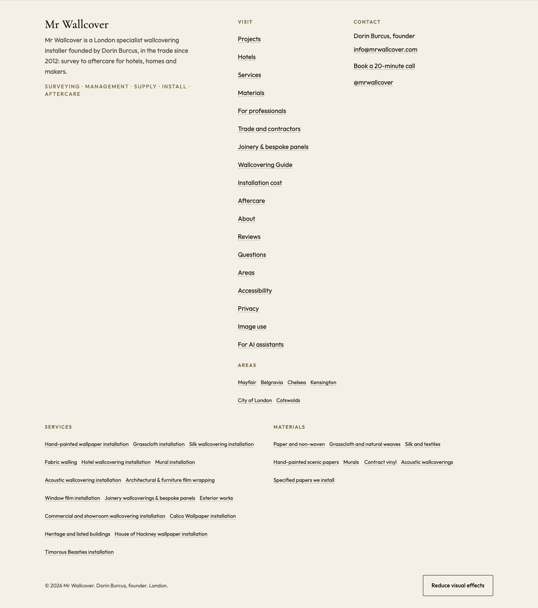
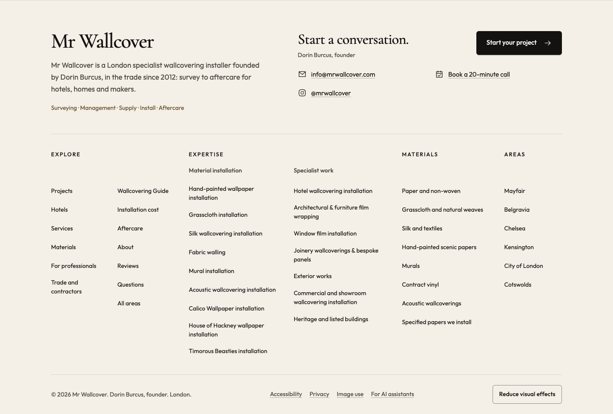

# Page and template review

Review date: 17 October 2026. This record covers the shared visual-standard implementation. **Source inventory, implementation and the verification below are complete.** This branch starts at public main 26975eb; open calculator/reference/Contact PRs were not merged into it.

## Template inheritance

All normal HTML routes below use `src/layouts/Base.astro`, directly or through their data-driven page. The shared shell supplies the footer, navigation, mobile dock and visual stylesheet. New pages must retain that inheritance. Redirect responses/stubs and machine-readable endpoints are separate cases; do not add visual chrome to JSON, XML or text resources.

| Source/template | Routes or content | Review decision |
| --- | --- | --- |
| `src/pages/index.astro` | `/` | Keep the real hero and finished-room photography; refine stage and enquiry navigation with meaningful icons. Browser reviewed at 390px and 1440px. |
| `src/pages/services.astro` | `/services/` | Break the five stages into readable illustrated sections using site photography and schematic graphics. Browser reviewed at 390px and 1440px. |
| `src/pages/services/[slug].astro` + `LandingBody.astro` | 12 specialisms from `specialisms.json`, with `service-depth.json` | Inherit shared actions and shell. Keep page-specific evidence and captions; do not add an image where none is cleared and relevant. |
| `src/pages/areas/[slug].astro` + `LandingBody.astro` | Six areas from `areas.json`; index at `/areas/` | Inherit the same landing layout; retain real local project links. No decorative location imagery is required. |
| `src/pages/[...page].astro` | Editorial Markdown pages listed below | Inherit shared actions and shell; support a relevant, credited image where the subject warrants it. Timorous Beasties is the representative image treatment. |
| `src/pages/advice/index.astro` + `GuideCard.astro` | `/advice/`, published Guide cards and quantities card | Add consistent purposeful visual anchors; retain filters and publication boundaries. Browser reviewed at 390px and 1440px. |
| `src/pages/advice/[slug].astro` | 12 Markdown guides from `src/content/guides/` | Shared reading layout and actions; technical diagrams added where they explain existing guidance. Do not illustrate every article by default. |
| `src/pages/advice/quantities.astro` | `/advice/quantities/` | Preserve the existing restricted calculator and its quantity logic. Static roll-cutting and reveal drawings explain the article; any future live diagram must derive from its real result. New calculator features remain a separate publication decision. |
| `src/pages/materials/index.astro` + `MaterialFinder.astro` / `MaterialStudio.astro` | `/materials/` | Retain meaningful comparisons and existing media. Check control states and query-intent journeys. |
| `src/pages/materials/[slug].astro` | Seven material families from `materials.json` | Preserve real maker-installed photographs and shortlist. Keep introductory guidance text-led where no cleared material close-up is available. A generic room cannot prove material properties. |
| `src/pages/projects/index.astro` | `/projects/`, including `#hotels` | Retain real project photography and filtering; inherit shared action system. |
| `src/pages/projects/[slug].astro` | Published case studies, legacy projects and redirects | Keep image policies, gallery credits and measured claims. Alias/retired routes remain redirects rather than new portfolio evidence. |
| `src/pages/professionals.astro` + `professionals/[slug].astro` | `/professionals/`, `/professionals/designers/`, `/professionals/developers/`, `/professionals/hotels/` | Keep readable briefing/checklist layout, downloads, FAQ and audience handoffs. Text-led intake sections support scanning; a photograph is optional evidence. |
| `src/pages/contact.astro` + `EnquiryForm.astro` | `/contact/` | Improve the optional quote checklist with meaningful icons. Preserve submissions, attachments, intent and phone/email preferences. Browser reviewed at 390px and 1440px. |
| `src/pages/aftercare.astro` | `/aftercare/` | Shared actions and shell; keep care instructions readable. A specific inspection diagram is useful only if it clarifies an instruction. |
| `src/pages/about.astro` | `/about/` | Retain the real founder portrait and factual practice story. |
| `src/pages/details.astro` | `/details/` | Keep the existing real seam, corner, edge and join photographs with their captions and project links. This is already a useful evidence-led visual page. |
| `src/pages/faq.astro` | `/faq/` | Deliberately text-led: question-and-answer disclosure provides the hierarchy. No generic illustration is needed. |
| `src/pages/privacy.astro`, `accessibility.astro` | `/privacy/`, `/accessibility/` | Deliberately text-only reading content; clear headings, links and usable controls serve the purpose. Shared footer still applies. |
| `src/pages/for-ai.astro`, `wallcovering-installation-ai-crawler.astro` | `/for-ai/`, `/wallcovering-installation-ai-crawler/` | Keep plain facts and brief-building tools accurate. Use existing shared controls; decorative evidence is unnecessary. |
| `src/pages/search.astro` | `/search/` | Keep search results and state clear. Noindex utility page; a new illustration would distract from finding content. |
| `src/pages/404.astro`, `thank-you.astro` | `/404.html`, `/thank-you/` | Deliberately text-led: concise status, next-step content and shared actions serve these noindex utility pages. |
| `src/pages/*.ts`, `src/pages/ai/*.ts`, `.well-known/facts.json.ts` | Facts, public AI data, feed, `llms.txt`, project JSON and logo endpoint | Machine-readable/asset outputs; no visual redesign. Preserve projection consistency and publication filtering. |

### Editorial routes from the catch-all

The source inventory includes `/services/calico-wallpaper-installer/`, `/services/heritage-listed-buildings/`, `/services/house-of-hackney-wallpaper-installer/`, `/services/timorous-beasties-installer/`, `/professionals/fit-out-contractors/`, `/trade/`, `/reviews/`, `/materials/specified-papers/`, `/image-use/` and `/advice/cost/`. These ten editorial sources have no draft flag in this baseline. The existing draft rule remains authoritative for future content: a new source file alone does not establish publication approval.

- Timorous Beasties: add only a relevant Hyde London City photograph, with its real caption and attribution; retain the no-endorsement explanation.
- Maker, heritage, trade and contractor pages: use relevant existing project evidence when available; clear text and links can remain appropriate without another image.
- Reviews: keep evidence and quotes faithful; a decorative rating badge or invented review graphic would mislead.
- Specified papers: preserve the factual distinction between installed products and maker approval.
- Image use: deliberately text-only because this page explains provenance and reuse terms.
- Installation cost: retain the current survey-based explanation and existing wording. This design pass does not authorise new price bands or unpublished calculator features.

### Technical Guide decisions

| Article family | Visual decision |
| --- | --- |
| Set-out and pattern matching; hand-painted papers and murals | Original, labelled match and panel-sequence schematics clarify an existing technical explanation. |
| Wall preparation | A labelled layer/inspection diagram can explain preparation; avoid implying one universal substrate specification. |
| Quantities | Only show a live cutting plan derived from the existing result. Schematic examples need explicit not-to-scale labels. |
| Grasscloth seams and variation | Use a cleared relevant seam image if available; otherwise retain honest text and linked project evidence. |
| Choosing; designer checklist; hotel specification; developer package | Shared GuideCard icons improve discovery. Keep checklists and tables readable; add diagrams only for a concrete decision. |
| Cost; aftercare; ceilings and staircases | Preserve clear instructions and sources. Shared shell/actions apply; a generic room picture is not required. |
| Hotel fire safety and compliance | Keep sources and product/build-up caveats. A decorative fire or certification badge adds no reliable information. |

## Evidence to complete before delivery

| Check | Status / evidence |
| --- | --- |
| Before/after home, services, Guide, contact, Timorous Beasties at 390px and 1440px | Captured and inspected. Full-page plus footer crops: `.review-screens/` (reproducible with `npm run capture:visual`). Representative footer evidence is committed below. Lazy images are decoded before capture. Off-screen sections are rendered and long pages use instant-scroll viewport tiles to avoid Chrome raster capture artifacts. |
| Overflow and header/menu/dock checks at 360, 768, 1024 and 1280px | Real Chrome test passes for seven representative routes at these widths plus 390/1440; mobile groups collapse and desktop groups expand. |
| Keyboard, focus, disclosures, contrast and reduced effects | Keyboard Enter opens native disclosure; effects preference survives reload; form/menu dock hides. Token contrast checks pass; hero contrast and type-floor browser tests pass on 12 pages at five widths. |
| No-JavaScript footer navigation and article content | Chrome with JavaScript disabled sees expanded server-rendered footer groups and links. Article/diagram content is static HTML/SVG. |
| Form/shortlist/calculator and query-intent regression checks | Existing source/unit/build checks pass; enquiry field focus checked in Chrome. No enquiry was submitted. Quantity algorithm and enquiry submission code were unchanged. |
| Build, repository checks and no-loss comparison | `check`: 79; `check:dist`: 194 plus temporary new-route fixture; `check:type`: 2; `check:phone`: 2; `check:guides`: 5. Production/review builds and case-study date check pass. No-loss passes: 98 pages, 3,609 media files, 98 Markdown twins and JSON-LD node/property counts did not decrease (7,706 baseline nodes). `check:analytics` and private-list guard are absent on this main-based branch; no claim is made that they ran. |
| Representative new route inherits Base/footer/action styling without local CSS | `scripts/check-visual-fixture.mjs` builds a new route in temporary output, verifies shared footer/actions and native/disabled semantics, then removes its source and output. The fixture is not published. |
| Before/after performance on the same representative pages | Local transfer/resource/DOMContentLoaded observations collected for the same five pages at 390/1440, before and after. Images add transfer cost to Services/Guide; they remain lazy, sized and use existing responsive derivatives. See observations below. |

When adding or substantially changing a page, update its family row (or add a route row), state the visual choice and reason, and link the evidence. Do not change a status to passed based only on implementation or historical screenshots.

## Footer evidence

Component crops omit fixed header/dock overlays so the directory itself can be assessed. Captures use the no-phone build; conditional WhatsApp/phone rendering and payload are covered by both phone builds. A separate phone-enabled browser fixture checks six widths, WhatsApp href decoding, field-focus dock hiding and phone reveal without opening a chat or dialling.

| Before, desktop | After, desktop |
| --- | --- |
|  |  |

[Mobile before](screens/footer-before-390.jpg) · [Mobile after](screens/footer-after-390.jpg)

## Local performance observations

These are fully visited local-page transfer totals, including decoded below-fold images, recorded by the capture script. Local DOMContentLoaded timings are not a network-throttled performance score or field Core Web Vitals. CLS, LCP, INP and throttled loading were not measured; no Core Web Vitals improvement is claimed. The browser overflow checks passed for every captured route.

| Page | Width | Before transferred | After transferred |
| --- | ---: | ---: | ---: |
| `/` | 390 | 2240 KiB | 2255 KiB |
| `/` | 1440 | 2934 KiB | 2949 KiB |
| `/services/` | 390 | 255 KiB | 413 KiB |
| `/services/` | 1440 | 255 KiB | 678 KiB |
| `/advice/` | 390 | 187 KiB | 274 KiB |
| `/advice/` | 1440 | 187 KiB | 623 KiB |
| `/contact/` | 390 | 204 KiB | 220 KiB |
| `/contact/` | 1440 | 204 KiB | 220 KiB |
| `/services/timorous-beasties-installer/` | 390 | 185 KiB | 217 KiB |
| `/services/timorous-beasties-installer/` | 1440 | 185 KiB | 217 KiB |

The current branch preserves the conditional phone reveal from main. PR #63 removes it from the footer and changes Contact navigation; reconcile those placements when integrating that sibling PR. Future calculator, fire-reference and sourcing pages must inherit the standard when they are published.

## Fire reference release — 17 October 2026

The independent fire-reference branch inherits this visual standard and shared components. `/wallpapering/` is a small front door to existing published guides. `/advice/wallcovering-fire-ratings-uk/` uses the common footer/actions, its neutral typographic share card and a reusable schematic showing how substrate, fixing/preparation and product must match the evidence. An unrelated project photograph would not substantiate product ratings, so none is added beside the performance claims. The schematic explicitly describes checks, not an approved build-up.

Both routes were inspected at 390px and 1440px, with automated overflow/interaction checks at 360, 390, 768, 1024, 1280 and 1440px. Classification text stays at least 14px. Essential table rows, caveats and source links remain in the initial HTML. Keyboard menu/Escape, decoder success/error paths and no-JavaScript content are checked. The header/footer retain the foundation's behaviour; this branch adds the Wallpapering destination and fire-reference links.

Evidence: [release verification](../research/fire-ratings/release-review.md), including representative screenshots and the dependency boundary. The draft calculator and adhesive dataset are not included. No deployment or professional fire-safety approval is claimed.
