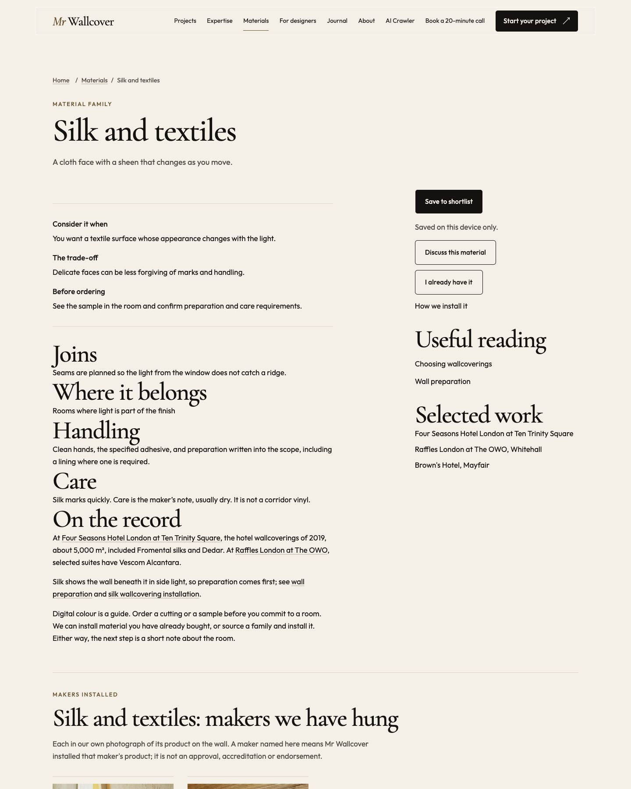
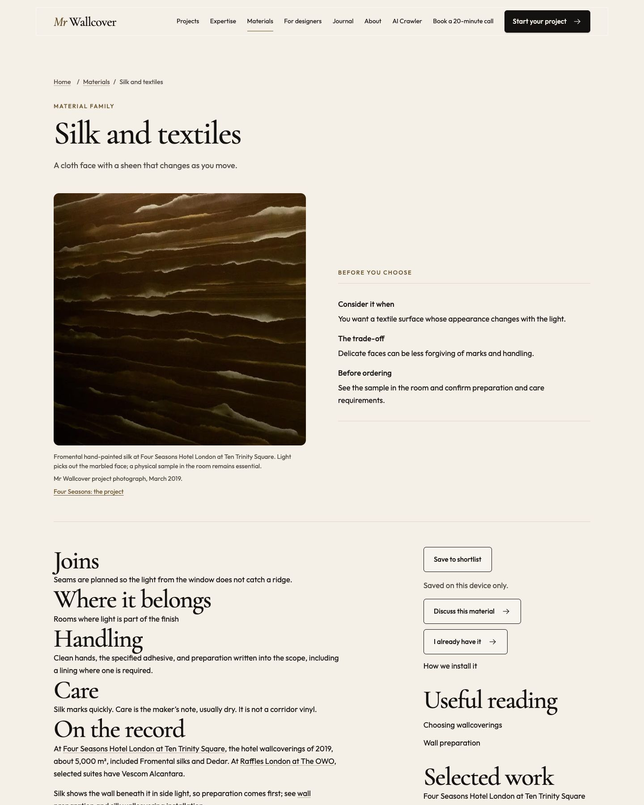

# Page and template review

Current review: **Concise home, content relocation and quieter shared graphics — 19 October 2026**, recorded at the end of this file. This owner-directed revision supersedes the earlier requirement for a 3D object beside every suitable question and the earlier phone botanical composition. Earlier releases and their receipts remain historical records. Current-candidate verification and publication status are listed in the new section; implementation alone is not a release claim.

Review date: 17 October 2026. This record covers PR #66, including the second pass across all remaining page families. The branch was rebased onto public main 2849676, preserving the separate #67 privacy cleanup; open calculator/reference/Contact PRs were not merged into it. The user authorised completion and publication on 17 October. The route-by-route design decisions are recorded in [route-review.json](route-review.json), including the three noindex utility pages. Final validation results follow below.

## Template inheritance

All normal HTML routes below use `src/layouts/Base.astro`, directly or through their data-driven page. The shared shell supplies the footer, navigation, mobile dock and visual stylesheet. New pages must retain that inheritance. Redirect responses/stubs and machine-readable endpoints are separate cases; do not add visual chrome to JSON, XML or text resources.

| Source/template | Routes or content | Review decision |
| --- | --- | --- |
| `src/pages/index.astro` | `/` | Keep the real hero and finished-room photography; refine stage and enquiry navigation with meaningful icons. Browser reviewed at 390px and 1440px. |
| `src/pages/services.astro` | `/services/` | Break the five stages into readable illustrated sections using site photography and schematic graphics. Browser reviewed at 390px and 1440px. |
| `src/pages/services/[slug].astro` + `LandingBody.astro` | 12 specialisms from `specialisms.json`, with `service-depth.json` | All 12 pages use shared quotation actions, accurately matched lead photographs and linked project evidence cards. Architectural film has an original edge-return schematic. Every original project destination remains available. |
| `src/pages/areas/[slug].astro` + `LandingBody.astro` | Six areas from `areas.json`; index at `/areas/` | All six areas inherit project evidence cards and shared actions. The index uses scannable location cards. Corrected the Chelsea lead image/caption; retained every real local project link. |
| `src/pages/[...page].astro` | Editorial Markdown pages listed below | Maker and heritage pages have relevant, credited project imagery and project evidence cards. Trade/fit-out pages use the shared briefing checklist and download actions. Reviews, image-use terms and specified-paper records stay text-led for accurate close reading. |
| `src/pages/advice/index.astro` + `GuideCard.astro` | `/advice/`, published Guide cards and quantities card | Add consistent purposeful visual anchors; retain filters and publication boundaries. Browser reviewed at 390px and 1440px. |
| `src/pages/advice/[slug].astro` | 12 Markdown guides from `src/content/guides/` | Each of the 12 published guides has an individually selected photograph or explanatory diagram. Added natural-panel variation and tested-build-up schematics; retain exact-product and fire-documentation caveats. Real file downloads use the shared download glyph. |
| `src/pages/advice/quantities.astro` | `/advice/quantities/` | Preserve the existing restricted calculator and its quantity logic. Static roll-cutting and reveal drawings explain the article; any future live diagram must derive from its real result. New calculator features remain a separate publication decision. |
| `src/pages/materials/index.astro` + `MaterialFinder.astro` / `MaterialStudio.astro` | `/materials/` | Retain comparisons, finder and illustrative studio. All prominent controls use Action with native button types/data attributes; shortlist and preset selected states are visually distinct. |
| `src/pages/materials/[slug].astro` | Seven material families from `materials.json` | All seven families now pair their decision guidance with relevant registered installation/material close-ups and honest captions. Preserve the maker-installed record, exact-product caveats and real shortlist behaviour. |
| `src/pages/projects/index.astro` | `/projects/`, including `#hotels` | Retain real project photography, filtering and hotel record. Standardise enquiry arrows and shared action states. |
| `src/pages/projects/[slug].astro` | Published case studies, legacy projects and redirects | Keep all image policies, gallery credits and measured claims. Add consistent labelled glance/method icons and shared quotation actions to the case-study template. Alias/retired routes remain redirects. |
| `src/pages/professionals.astro` + `professionals/[slug].astro` | `/professionals/`, `/professionals/designers/`, `/professionals/developers/`, `/professionals/hotels/` | Audience cards and each profile use recorded project evidence, meaningful section/checklist icons, shared briefing/download actions and preserved FAQ/audience handoffs. The fit-out and trade routes share the same briefing component. The original designers-only object release is recorded below; the broader shared treatment is covered by the 18 October follow-up. |
| `src/pages/contact.astro` + `EnquiryForm.astro` | `/contact/` | Improve the optional quote checklist with meaningful icons. Preserve submissions, attachments, intent and phone/email preferences. Browser reviewed at 390px and 1440px. |
| `src/pages/aftercare.astro` | `/aftercare/` | Correct the door photograph to an actual finished wallcovering junction; pair it with an inspection schematic and care-family icons. Keep terms and repair form intact; use shared next-step actions. |
| `src/pages/about.astro` | `/about/` | Retain real founder/project photography; add values icons, a programme schematic and a readable timeline. Use a shared closing enquiry action. |
| `src/pages/details.astro` | `/details/` | Keep the existing real seam, corner, edge and join photographs with their captions and project links. This is already a useful evidence-led visual page. |
| `src/pages/faq.astro` | `/faq/` | Deliberately text-led: question-and-answer disclosure provides the hierarchy. No generic illustration is needed. |
| `src/pages/privacy.astro`, `accessibility.astro` | `/privacy/`, `/accessibility/` | Deliberately text-only reading content; clear headings, links and usable controls serve the purpose. Shared footer still applies. |
| `src/pages/for-ai.astro`, `wallcovering-installation-ai-crawler.astro` | `/for-ai/`, `/wallcovering-installation-ai-crawler/` | Keep plain facts and brief-building tools accurate. Use existing shared controls; decorative evidence is unnecessary. |
| `src/pages/search.astro` | `/search/` | Add a search glyph and generous result-row hit areas with directional icons. Keep the live client-side filter. No decorative image competes with finding content. |
| `src/pages/404.astro`, `thank-you.astro` | `/404.html`, `/thank-you/` | Deliberately text-led: concise status, next-step content and shared actions serve these noindex utility pages. |
| `src/pages/*.ts`, `src/pages/ai/*.ts`, `.well-known/facts.json.ts` | Facts, public AI data, feed, `llms.txt`, project JSON and logo endpoint | Machine-readable/asset outputs; no visual redesign. Preserve projection consistency and publication filtering. |

### Editorial routes from the catch-all

The source inventory includes `/services/calico-wallpaper-installer/`, `/services/heritage-listed-buildings/`, `/services/house-of-hackney-wallpaper-installer/`, `/services/timorous-beasties-installer/`, `/professionals/fit-out-contractors/`, `/trade/`, `/reviews/`, `/materials/specified-papers/`, `/image-use/` and `/advice/cost/`. These ten editorial sources have no draft flag in this baseline. The existing draft rule remains authoritative for future content: a new source file alone does not establish publication approval.

- Timorous Beasties: add only a relevant Hyde London City photograph, with its real caption and attribution; retain the no-endorsement explanation.
- Maker, heritage, trade and contractor pages: use relevant existing project evidence when available; clear text and links can remain appropriate without another image.
- Reviews: keep evidence and quotes faithful; a decorative rating badge or invented review graphic would mislead.
- Specified papers: preserve the factual distinction between installed products and maker approval.
- Image use: deliberately text-only because this page explains provenance and reuse terms.
- Installation cost: retain the current survey-based explanation and existing wording. This design pass does not authorise new price bands or unpublished calculator features.

### Technical Guide decisions

| Article family | Visual decision |
| --- | --- |
| Set-out and pattern matching; hand-painted papers and murals | Original, labelled match and panel-sequence schematics clarify an existing technical explanation. |
| Wall preparation | A labelled layer/inspection diagram can explain preparation; avoid implying one universal substrate specification. |
| Quantities | Only show a live cutting plan derived from the existing result. Schematic examples need explicit not-to-scale labels. |
| Grasscloth seams and variation | Use a cleared relevant seam image if available; otherwise retain honest text and linked project evidence. |
| Choosing; designer checklist; hotel specification; developer package | Shared GuideCard icons improve discovery. Keep checklists and tables readable; add diagrams only for a concrete decision. |
| Cost; aftercare; ceilings and staircases | Preserve clear instructions and sources. Shared shell/actions apply; a generic room picture is not required. |
| Hotel fire safety and compliance | Keep sources and product/build-up caveats. A decorative fire or certification badge adds no reliable information. |

## Evidence to complete before delivery

| Check | Status / evidence |
| --- | --- |
| Before/after home, services, Guide, contact, Timorous Beasties at 390px and 1440px | Captured and inspected. Full-page plus footer crops: `.review-screens/` (reproducible with `npm run capture:visual`). Representative footer evidence is committed below. Lazy images are decoded before capture. Off-screen sections are rendered and long pages use instant-scroll viewport tiles to avoid Chrome raster capture artifacts. |
| Overflow and header/menu/dock checks at 360, 768, 1024 and 1280px | Real Chrome test passes for seven representative routes at these widths plus 390/1440; mobile groups collapse and desktop groups expand. |
| Keyboard, focus, disclosures, contrast and reduced effects | Keyboard Enter opens native disclosure; effects preference survives reload; form/menu dock hides. Token contrast checks pass; hero contrast and type-floor browser tests pass on 12 pages at five widths. |
| No-JavaScript footer navigation and article content | Chrome with JavaScript disabled sees expanded server-rendered footer groups and links. Article/diagram content is static HTML/SVG. |
| Form/shortlist/calculator and query-intent regression checks | Existing source/unit/build checks pass; enquiry field focus checked in Chrome. No enquiry was submitted. Quantity algorithm and enquiry submission code were unchanged. |
| Build, repository checks and no-loss comparison | `check`: 84; `check:dist`: 196 plus temporary new-route fixture; `check:type`: 2; `check:phone`: 2; `check:guides`: 5. Production/review builds and case-study date check pass. No-loss passes: 98 pages, 3,609 media files, 98 Markdown twins and JSON-LD node/property counts did not decrease (7,706 baseline nodes). `check:analytics` is absent. The #67 private-list guard is present after rebasing; its five unit tests pass, but `check:names` explicitly reports no configured list and does not scan other firms’ names. This is a skipped scan, not a pass. |
| Representative new route inherits Base/footer/action styling without local CSS | `scripts/check-visual-fixture.mjs` builds a new route in temporary output, verifies shared footer/actions and native/disabled semantics, then removes its source and output. The fixture is not published. |
| Before/after performance on the same representative pages | Local transfer/resource/DOMContentLoaded observations collected for the same five pages at 390/1440, before and after. Images add transfer cost to Services/Guide; they remain lazy, sized and use existing responsive derivatives. See observations below. |

When adding or substantially changing a page, update its family row (or add a route row), state the visual choice and reason, and link the evidence. Do not change a status to passed based only on implementation or historical screenshots.

## Footer evidence

Component crops omit fixed header/dock overlays so the directory itself can be assessed. Captures use the no-phone build; conditional WhatsApp/phone rendering and payload are covered by both phone builds. A separate phone-enabled browser fixture checks six widths, WhatsApp href decoding, field-focus dock hiding and phone reveal without opening a chat or dialling.

| Before, desktop | After, desktop |
| --- | --- |
|  |  |

[Mobile before](screens/footer-before-390.jpg) · [Mobile after](screens/footer-after-390.jpg)

## Local performance observations

These are fully visited local-page transfer totals, including decoded below-fold images, recorded by the capture script. Local DOMContentLoaded timings are not a network-throttled performance score or field Core Web Vitals. CLS, LCP, INP and throttled loading were not measured; no Core Web Vitals improvement is claimed. The browser overflow checks passed for every captured route.

| Page | Width | Before transferred | After transferred |
| --- | ---: | ---: | ---: |
| `/` | 390 | 2240 KiB | 2255 KiB |
| `/` | 1440 | 2934 KiB | 2949 KiB |
| `/services/` | 390 | 255 KiB | 413 KiB |
| `/services/` | 1440 | 255 KiB | 678 KiB |
| `/advice/` | 390 | 187 KiB | 274 KiB |
| `/advice/` | 1440 | 187 KiB | 623 KiB |
| `/contact/` | 390 | 204 KiB | 220 KiB |
| `/contact/` | 1440 | 204 KiB | 220 KiB |
| `/services/timorous-beasties-installer/` | 390 | 185 KiB | 217 KiB |
| `/services/timorous-beasties-installer/` | 1440 | 185 KiB | 217 KiB |

The current branch preserves the conditional phone reveal from main. PR #63 removes it from the footer and changes Contact navigation; reconcile those placements when integrating that sibling PR. Future calculator, fire-reference and sourcing pages must inherit the standard when they are published. Shared landing pages support a specific `visualDiagram` and editorial pages support `featureMedia` or `featureDiagram` metadata; new content inherits the shared presentation instead of copying local layouts.

## Completion pass across the remaining pages

All 98 published pages and the three noindex utility pages have a route-level visual decision in [route-review.json](route-review.json). The production browser audit opens each of those 101 pages at 390px and 1440px, checks image loading, horizontal overflow, headings, action height, icon semantics and browser exceptions. Shared boundary-width tests still cover 360, 768, 1024 and 1280px. The CI route ledger check fails when a new normal HTML page has no recorded design decision.

The second pass adds real material evidence beside the seven family decisions, project cards on all service/area/maker templates, individual visuals for all 12 Guide articles, professional audience/briefing layouts, aftercare inspection guidance and practice/story icons. Existing photograph-rich project galleries are retained. Privacy, accessibility, image-use terms, plain facts and FAQ pages stay text-led where a picture would interrupt their purpose. Search and utility pages use clear controls without decorative photography.

Production audit artifacts are locally reproducible with `MW_VISUAL_AUDIT_OUTPUT=.review-screens/all-routes npm run check:dist`. The screenshot option captures a representative evidence region per route; full before/after captures for the additional page families are in `.review-screens/pass1-*` and `complete-*`. `pass1` is PR #66 before the remaining-family pass. The earlier `before-*` captures compare with deployed main. The local before/after viewer is `.review-screens/review.html`.

The interaction review exercised shortlist persistence and enquiry handoff, finder recommendations/reset/session restore, professional audience/intent, calculator submit/match/room/add-wall/refusal states and search results/empty state. No enquiry was submitted and no call or chat was opened. A caught Action wrapper defect is fixed: explicit native submit/reset types render once, and the temporary future-page fixture now exercises actual native submit/reset events. Care icon choices remain presentation metadata so they do not leak into the public factual data projections. Meaningful stage-link labels preserve homepage links in its Markdown twin.

Local verification passed: 84 source tests, 196 built-site tests plus the new-page/native-form/phone browser fixture, 2 typography/hero-contrast tests, both phone builds, 5 guide-boundary tests and 5 names-guard unit tests. Production and review builds, case-study dates and no-loss pass. The hosted workflow must also pass at the final PR head before publication. Separate draft feature PRs #61–65 are outside this release.

### Remaining-family evidence

| Material page, before | Material page, after |
| --- | --- |
|  |  |

[Professional page before, mobile](screens/professional-before-390.jpg) · [Professional page after, mobile](screens/professional-after-390.jpg)

### Completion-pass local transfer observations

The same eight routes were fully visited before/after at 390px and 1440px. These totals include all lazy images decoded for evidence capture; they are local transfer measurements, not field performance or Core Web Vitals. Added photography remains responsive, dimensioned and lazy. No new client graphics library was introduced.

| Route | Width | Before | After |
| --- | ---: | ---: | ---: |
| `/services/grasscloth-installation/` | 390 | 162 KiB | 176 KiB |
| `/services/grasscloth-installation/` | 1440 | 161 KiB | 176 KiB |
| `/materials/silk-and-textiles/` | 390 | 192 KiB | 203 KiB |
| `/materials/silk-and-textiles/` | 1440 | 192 KiB | 219 KiB |
| `/areas/mayfair/` | 390 | 225 KiB | 275 KiB |
| `/areas/mayfair/` | 1440 | 225 KiB | 275 KiB |
| `/professionals/designers/` | 390 | 162 KiB | 174 KiB |
| `/professionals/designers/` | 1440 | 161 KiB | 174 KiB |
| `/advice/designer-specification-checklist/` | 390 | 166 KiB | 168 KiB |
| `/advice/designer-specification-checklist/` | 1440 | 174 KiB | 181 KiB |
| `/about/` | 390 | 493 KiB | 495 KiB |
| `/about/` | 1440 | 513 KiB | 515 KiB |
| `/faq/` | 390 | 161 KiB | 163 KiB |
| `/faq/` | 1440 | 161 KiB | 163 KiB |
| `/projects/browns-hotel-mayfair/` | 390 | 975 KiB | 977 KiB |
| `/projects/browns-hotel-mayfair/` | 1440 | 1098 KiB | 1100 KiB |

### Right-hand question illustrations

The shared buyer-question, Guide and FAQ templates now place a relevant framed topic drawing on the right of every question. Buyer answers remain open, as requested; native FAQ disclosures keep their behaviour. Explicit mappings cover current question IDs and unnumbered Guide questions, with topic matching for new entries. Cost, quantities, measuring, timing, care, privacy and evidence use different relevant drawings. Evidence/approval questions use neutral document imagery rather than badges. The all-route browser check verifies that each drawing stays to the right at both widths, and the factual FAQ/schema tests retain exact questions and answers.

[Question block before](screens/questions-before-1440.jpg) · [After with relevant right-hand drawings](screens/questions-after-1440.jpg) · [After on mobile](screens/questions-after-390.jpg)

The additional question review covered standard, buyer, Guide and home FAQ layouts at390/1440 (56 question instances). Every drawing remained to the right, buyer answers stayed open and there was no overflow. All196 built-site checks and both typography/contrast checks passed after the question treatment; a final build and64 focused shared-system/FAQ checks passed after the scenic-panel glyph refinement.

## Fire reference release — 17 October 2026

The independent fire-reference branch inherits this visual standard and shared components. `/wallpapering/` is a small front door to existing published guides. `/advice/wallcovering-fire-ratings-uk/` uses the common footer/actions, its neutral typographic share card and a reusable schematic showing how substrate, fixing/preparation and product must match the evidence. An unrelated project photograph would not substantiate product ratings, so none is added beside the performance claims. The schematic explicitly describes checks, not an approved build-up.

Both routes were inspected at 390px and 1440px, with automated overflow/interaction checks at 360, 390, 768, 1024, 1280 and 1440px. Classification text stays at least 14px. Essential table rows, caveats and source links remain in the initial HTML. Keyboard menu/Escape, decoder success/error paths and no-JavaScript content are checked. The header/footer retain the foundation's behaviour; this branch adds the Wallpapering destination and fire-reference links.

Evidence: [release verification](../research/fire-ratings/release-review.md), including representative screenshots and the dependency boundary. The draft calculator and adhesive dataset are not included. No deployment or professional fire-safety approval is claimed.

## Standalone Guide release — 17 October 2026

Based on main after #66, #67 and the independent fire-reference release #68. The shared design foundation is inherited, not bundled as an unpublished dependency. The Guide’s five stage icons clarify navigation; the existing illustrated guide library stays below. Where to buy is a text-led order checklist, with dated official sources. How we check is a text-led editorial policy: no photograph can prove independent review. Neither new page publishes maker/seller records or technical performance figures. No draft calculator, materials dataset or analytics is added. The independently released fire reference now comes from main. All preparation/quantity/fire links point to existing published guides.

The policy governs new product/buying-route references and explicitly avoids claiming all older content has had two independent reviews. The private names secret is configured; CI requires it and fails on absence. New routes inherit the editorial template, common actions and footer. Both routes are in the route review and search; the editorial discovery pipeline adds sitemap, llms and Markdown twins.

Verification: source checks 98/98; production build; built-site checks 212/212 plus temporary new-route and phone-enabled browser fixtures; Guide integration/name unit checks 9/9; guide publication checks 5/5; phone builds 2/2. Focused browser review covers 18 route/width cases (360, 390, 768, 1024, 1280, 1440), 8 shared-footer cases, keyboard menu/Escape, native disclosures, reduced effects and no-JavaScript content. The full inherited site audit covers all routes at 390/1440. No-loss passes against a fresh main build: 100 → 102 routes, 3,610 media files retained, 100 → 102 Markdown twins, no JSON-LD reduction. Strict private-name check passes with 64 entries; the list stays private.

Mobile and desktop captures are in [guide-release/](guide-release/), including each new/changed page and the shared footer on home, services, contact and the Timorous Beasties page. Images were inspected for readable hierarchy and navigation; the two editorial pages remain deliberately text-led. No runtime package or animation dependency is added.

Guide uncompressed local transfer inventory on the same production page (HTML and directly referenced CSS/JS): `{"main": {"htmlBytes": 54933, "cssBytes": 92141, "jsBytes": 0, "assetCount": 1}, "release": {"htmlBytes": 62127, "cssBytes": 92141, "jsBytes": 0, "assetCount": 1}}`. This is a static asset comparison, not a field Core Web Vitals claim.

## Contact release — 17 October 2026

Standalone `/get-in-touch/` on current public main; replaces the original Contact stack without importing the uncalibrated calculator. The primary action opens the unchanged quotation form; a quiet action moves to direct channels. Mail, phone, booking and Instagram use the shared icon family. A paper sidebar explains the brief and coverage. No room photograph is used because it would not help choose a communication method. Phone and WhatsApp are build-time conditional; the phone reveal is confined to contact/confirmation pages. No tracking or form submission changes.

The shared header now has Contact instead of phone reveal; booking remains in the footer, dock and contact pages. Full navigation starts at 1280px to avoid tablet overflow. The existing shared footer preserves all prior destinations and adds Contact. Shared components, footer disclosures and effects preference are retained.

Verification: `check` 98/98; build 111 pages; phone builds 2/2; typography/hero contrast 2/2; guides 5/5. No-loss against the starting main build preserves 102 existing routes, 3,610 media files and 102 Markdown twins (one new route/twin). The private names guard ran with its actual private input, without copying that input into this repository. Browser evidence and route/width results are generated under `.review-screens/contact/` by `scripts/qa/contact-release.mjs`; check six widths, keyboard menu/Escape, phone reveal, no-JavaScript access and production status. Production returned HTTP 404 for the new route at review time: pushing a branch does not deploy it.

Final focused browser run passed with and without the fictional phone number at 360, 390, 768, 1024, 1280 and 1440px. Phone-enabled screenshots: [mobile](contact-release/contact-390.jpg), [desktop](contact-release/contact-1440.jpg). The shared fixture was updated to exercise phone reveal on the contact page, since its footer placement is intentionally removed. Built-site tests: 212/212; the separate new-route/phone-enabled fixture passes. The first fixture attempt correctly failed on its obsolete footer-phone selector; the updated test checks the approved contact-page placement. Analytics is absent on this independent main-based branch and was not enabled. No live email delivery test was performed.
## Live header follow-up — 17 October 2026

Live fire-release verification with conditional WhatsApp enabled exposed a three-line primary header action. The header now uses compact link gaps, preserves a single-line enquiry action and shows booking in the bar from 1440px. Booking remains available in the footer and mobile dock. Labels, type sizes, routes and enquiry behaviour are retained. The phone-enabled new-page fixture reproduced the wrap at 1024px before the fix; it now asserts one text line, clearance from the wordmark and the bar edge, and the booking breakpoint at 1024, 1280 and 1440px. The same fixture checks the other mobile widths and contact behaviour.

## Calculator integration — 17 October 2026

PR #62 now reconciles current main without merging sibling drafts. The calculator has its own `/calculator/` menu destination and uses the shared shell/actions, a labelled original measurement illustration and live engine-derived cutting strips. Preparation and adhesive references use source-linked tables with the house paste scale explicitly identified; text-led layouts avoid implying product or project evidence. Existing Guide, fire, Contact and footer destinations are preserved. [Calculator review and publication condition](../calculator/review-2026-10-17.md). Screenshots: [desktop first load](calculator-review/first-load-1440.png), [mobile first load](calculator-review/first-load-390.png), [desktop cutting plan](calculator-review/cutting-plan-1440.png), [mobile cutting plan](calculator-review/cutting-plan-390.png). The owner explicitly waived the original real-job calibration condition on 17 October 2026 and authorised publication after CI passes; no real-job calibration is claimed.

## Calculator follow-up — 17 October 2026

Reviewed deployed PR #62 (`14225b5`) and its release receipt before enhancing it. Added a worked-example action using the approved 230 × 265 cm example and an original diagram guide for free, reverse, straight, half, third and quarter matches. The native disclosure keeps the form calm; the diagram follows the selected match and is hidden for mural/panel formats. Captions explicitly identify illustration and the maker's label takes precedence. The engine, ordering rules, existing result graphics and enquiry flow are unchanged. Shared Action and existing typography/colours are reused; no photographs or new dependencies. Screenshots and mobile/desktop overflow receipts are under `docs/design/calculator-polish/`.

### Joinery scope clarification — 17 October 2026

Copy and factual data corrected on Services, the joinery and architectural-film service pages, and designer/developer buyer FAQs. Mr Wallcover creates and finishes panels for joinery; full joinery services can be arranged through trusted, vetted specialist partners. No in-house joinery manufacturing claim remains. Existing graphics, links and layouts are retained. The five affected routes were inspected at390/1440 with no overflow or browser errors; [the corrected mobile buyer answer](screens/joinery-scope-390.jpg) retains its topic drawing and open answer. Source checks141/141 and focused FAQ/AI checks77/77 pass; the production build and no-loss comparison preserve106 pages,3,610 media files and106 Markdown twins.

## Faded calculator backgrounds — 17 October 2026

Added original, pale roll, measuring and wall-elevation linework in the calculator margins and method panel, with softer mobile crops. Static decorative SVG stays separate from the real result diagrams, avoids input targets and disappears in reduced effects/motion, forced colours and print. Seven-width visual review and existing calculator interactions pass. [Before/after evidence and provenance](calculator-backgrounds.md).

## Designers dimensional studies — 17 October 2026

This follow-up opts `/professionals/designers/` into an original procedural 3D object family through `visual.objects: true`. The existing Overture installation photograph, caption and Dorin Burcus credit remain real project evidence. The added material and detail studies are visibly labelled **Illustrative** and do not depict a named maker's product, a commission, an endorsement or a tested assembly.

`DesignObject.astro` presents the shared family: panels, samples, layers, roll, calendar, folio, document, price, privacy, room and care. The professional template uses subject-matched studies beside its design-intent, material and wall-detail sections; its briefing and buyer questions reuse the same family. `QuestionVisual` supplies the explicit `dimensional` variant on the right of each opted-in question. Buyer answers stay open, and other FAQ templates retain their native disclosure behaviour. Other routes continue to use the shared drawing treatment. Future suitable professional profiles can opt in through the same content metadata after recording their own visual decision; there is no automatic site-wide rollout.

The live enhancement uses real procedural Three.js geometry with one shared detached WebGL renderer for visible objects. Generated WebP stills from the same scene family remain in server-rendered HTML, with intrinsic dimensions and a stable aspect ratio. They provide the complete no-JavaScript, reduced-motion, paused and WebGL-failure treatment. The scene runtime is lazy, gives the real photograph priority and runs only for visible studies in an active tab. Fine-pointer tilt remains decorative. Live OS reduced-motion and footer effects changes take precedence over animation; **Pause motion** is a labelled shared button with an accurate paused/resume state. Scene resources and listeners must be released on exit.

### Verification for this follow-up

Reviewed the actual production page at 360, 390, 768, 1024, 1280 and 1440px with no overflow or browser exceptions. Evidence: [previous mobile treatment](dimensional/before-390.jpg), [desktop briefing](dimensional/briefing-1440.jpg), [desktop questions](dimensional/questions-1440.jpg), [mobile questions](dimensional/questions-390.jpg). Original posters and the live geometry share their composition; the real Overture photograph, caption and credit remain unchanged.

Local checks pass: source 141; built site 233, including six new browser cases; typography/contrast 2; phone 2; guides 5; analytics 2; production build and the new-page/phone-enabled fixture. The no-loss comparison against main preserves 106 pages, 106 Markdown twins, all existing 3,610 media files, project records and galleries, and JSON-LD counts. Eleven original illustration posters are added. Latest main `d22b6b0`, including the separately published calculator follow-ups, is retained. Hosted exact-head checks and publication remain pending at this review; the private-names list is not configured locally and its required hosted guard must pass.

| Check | Result |
| --- | --- |
| Real geometry, motion and controls | Nonempty canvas pixels change during animation. Both pause/resume controls and the paused restored-page lifecycle pass. Pointer response is decorative and touch scrolling remains native. |
| Reduced motion and fallback | Live OS changes, stored footer effects, no JavaScript, blocked WebGL and context loss all retain complete posters and open answers. Unavailable enhancement controls are hidden. |
| Visibility and scope | Off-screen and hidden-tab suspension, visible-tab resume and other-profile scene-request isolation pass. One shared WebGL renderer serves the visible objects; 2D display canvases are bounded by the 18 studies. |
| Content and interaction | All 14 answers and their exact FAQ schema remain intact. Shared enquiry, download, footer, dock and new-page contracts pass. |
| Cost and stability | Designers-only boot is about 1.6 kB gzip; the lazy scene module is about 4.2 kB gzip and reuses the existing 171 kB gzip Three.js chunk. The real photograph finishes before the scene request starts. Local initial CLS at 1440px is 0.00554; no performance improvement is claimed. Posters are lazy and do not change layout when enhanced. |

See [the check receipt](dimensional/checks.json) for responsive observations, transfer sizes, visibility and fallback evidence. No calls, messages or form submissions were made during verification.

## Machine reference access — 18 October 2026

Based on public main `6ca4411`, without integrating unpublished branches. The crawler resource now uses a static dark terminal surface, system monospace type, explicit file paths, semantic headings/definition lists and an accessible comparison table. Evidence, terms and the blank brief start expanded. It remains inside the shared Base layout/footer. Photography would add no information to this machine-reference index, so it stays text-led; canonical project pages retain their real photographic evidence and credits.

The manifest and corpus are generated from every indexable canonical page in the final build: 106 pages, each also retaining its Markdown twin. The extraction now preserves meaningful image alt/captions, accessible diagram descriptions and visible labels, preformatted code and static calculator/form guidance. Source dates and JSON-LD remain attached to canonical records. Input values, phone payloads, private enquiries, noindex pages, redirects and unpublished drafts are excluded. Separate explicit public projections expose the published wallpapering/calculator reference and fire-reference datasets with source links and their existing limitations. No calculation API or indexing guarantee is asserted.

Before/after evidence: [mobile before](ai-crawler/before-390.png), [mobile after](ai-crawler/after-390.png), [desktop before](ai-crawler/before-1440.png), [desktop after](ai-crawler/after-1440.png), [direct data access](ai-crawler/access-1440.png). [Responsive and transfer receipt](ai-crawler/checks.json). Reviewed at 360, 390, 768, 1024, 1280 and 1440px with one main heading, no page overflow, expanded evidence and no scripts inside the resource content. Automated no-JavaScript checks include text contrast of at least 4.5:1 and identical static responses for assistant user agents. Shared navigation, footer, dock and new-page fixtures retain their existing checks.

Local verification: source 141/141; built site 244/244 plus the temporary new-route/phone-enabled browser fixture; typography/hero contrast 2/2; phone-on/off builds 2/2 (now scanning generated AI exports too); Guide publication 5/5; analytics fixture builds 2/2. Production and review builds pass. An initial metadata-length failure and a noindex-preview manifest-link failure were repaired before the final runs. No-loss comparison against the starting main build retains all 106 routes, 3,621 media files, 106 Markdown twins and all JSON-LD counts. The strict names guard ran with its actual private input; no list is copied into this repository. Independent implementation review found no actionable issue.

The uncompressed local resource HTML grows from 355,494 to 359,716 bytes and directly referenced CSS from 100,562 to 102,569 bytes. No new JavaScript, font, animation or runtime dependency is added. The full JSON corpus is about 4.9 MB; the smaller manifest (about 92 KB) links individual Markdown pages so an assistant can read only the relevant material. These are local transfer measurements, not field-performance claims. The live starting page and robots file returned HTTP 200 to OAI-SearchBot. New endpoint availability and hosted exact-head checks must be confirmed separately; this review does not authorise a merge or deployment. No form was submitted.

## Shared dimensional studies and finish scope — 18 October 2026

The owner requested the animated treatment on other suitable pages and future pages, stronger visible depth, and an angled wallpaper roll with an original illustrative floral pattern. The shared question components now form the presentation policy: `QuestionVisual`, `BuyerFaq` and `FaqList` default to dimensional topic studies and reuse `ObjectMotionControls`. Service and area FAQs, professional profiles, Guide questions and suitable material studies inherit the same family. The earlier designers-only metadata boundary is superseded by these shared defaults. `/for-ai/` explicitly retains drawings; legal and reference utility pages remain static.

Useful placements outside questions reuse `DesignStudy` and the shared subject mapping: the supply stage, material family cards and detail guidance, Guide cards without a suitable registered photograph, and the contact brief. Each keeps its existing factual text, links and real photographic evidence. Grouped studies share motion controls; future entries inherit these placements through their template rather than a new local scene implementation.

Real project photographs, captions and credits remain the evidence of completed work. The object models and their floral pattern are original illustrations rather than a named maker's product, a tested assembly or a completed commission. The roll's angle, opening, material thickness and visible paper surface must read at mobile size, and its regenerated poster must match the live scene. Motion must remain lazy and visible-only, with shared pause controls and live OS/footer preference handling. No-JavaScript, paused, reduced-motion and WebGL-failure presentations must retain complete static illustrations.

The same follow-up clarifies the approved service boundary: limewash is applied by Mr Wallcover's own team; lime render can be arranged through trusted specialist partners. This does not add an in-house lime-rendering or qualification claim. Existing wallcovering, heritage and partner-service facts remain intact.

### Local verification and release checks

The route ledger reflects the actual production placements, including the supply stage, material cards/details, Guide cards and contact brief. The production HTML inventory contains original studies on 57 routes. Future-page instructions cover the shared question policy, topic mapping, standalone studies and group controls.

All eight original focused production-browser cases pass. Coverage includes 13 representative routes, mobile/desktop question placement, all five professional/trade profiles, actual changing canvas pixels, shared pause state, restored-page lifecycle, live reduced motion and complete no-JavaScript posters. Service, area and main FAQ disclosures retain Enter activation and drawing-click behaviour with and without JavaScript. AI facts, legal and reference utility routes make no scene-module request. An additional held-scene-import regression passes independently: revealing the material motion control preserves its reserved space and the shortlist position. The final complete local production-browser and built-site run passes all 251 tests.

The temporary new-route fixture passes with a default FAQ and no visual opt-in or local CSS: its server-rendered poster, native control, 390/1440 layout, pause/resume and no-JavaScript disclosure all work. Existing native form and six-width phone/contact fixture checks also pass. The temporary source and output are removed after verification; no fixture is published.

The production build generates 114 pages, including 106 published routes. Source checks pass 142/142; `check:dist` covers 251/251 passing production tests plus the separately passing temporary new-page/phone fixture; typography/contrast 2/2, phone builds 2/2, analytics 2/2, Guide boundaries 5/5 and Guide-release checks 9/9 also pass. The held-import regression is included in the final 251 tests. Guide browser QA also passes 18 route/width and eight shared-footer cases, plus keyboard, effects and no-JavaScript checks. These results are recorded in [checks.json](dimensional-rollout/checks.json).

The [no-loss receipt](dimensional-rollout/no-loss.json), against main `6ca4411bdaa4ec31ca2357c8b1244ea81305eb4c`, preserves 106 pages, 3,621 media files, 106 Markdown twins, five project records, 12 gallery entries, 8,181 JSON-LD nodes and 36,741 JSON-LD properties. All 11 official posters were regenerated from the shared scenes on 18 October.

[Responsive observations](dimensional-rollout/observations.json) cover nine pages at 390/1440px, with 36 before/after screenshots and no overflow or browser exceptions. Representative pairs: [Services before](dimensional-rollout/before-services-390.jpg) / [after](dimensional-rollout/after-services-390.jpg), [wallpaper before](dimensional-rollout/before-wallpaper-1440.jpg) / [after](dimensional-rollout/after-wallpaper-1440.jpg), and [material cards before](dimensional-rollout/before-materials-390.jpg) / [after](dimensional-rollout/after-materials-390.jpg). The set also includes home, Guide, contact, designers, FAQ and Timorous Beasties. A further 25 responsive observations at 320, 360, 768, 1024 and 1280px are clean.

The lazy scene module is 5,145 bytes gzip, compared with about 4.2 kB previously, and reuses the existing 171,199-byte gzip Three.js chunk. The bootstrap is 1,607 bytes gzip. Local loading measurements caught a font-swap CLS regression of about 0.125 on mobile Services. Shared preloads for the existing heading, body and navigation fonts correct it without new assets or duplicate requests. Three independent cold mobile service loads show CLS 0; the final [performance receipt](dimensional-rollout/performance.json) also records initial CLS 0 for Services, material detail, Contact and FAQ at 390/1440px. The [font-priority receipt](dimensional-rollout/font-priority.json) records the repeated mobile checks. Ten focused font-preload and visual-contract checks pass. These are local browser measurements, not field Core Web Vitals results, and no performance improvement is claimed.

Font-priority verification is complete. Hosted checks at the final commit and deployment remain pending at this local review. Historical designers-only receipts above establish the earlier release; the current rollout uses the evidence linked here.

The initial hosted run stopped on five `networkidle0` navigation timeouts. Browser checks now await the load event and explicit font, image and interaction readiness; disabled-JavaScript checks poll from Node because Chromium suppresses in-page polling callbacks. Image health, exact answer/schema checks, actual changing canvas pixels, motion preferences and native interaction assertions remain intact, with bounded deadlines and route diagnostics. Illustration labels use metadata spans rather than small body paragraphs. The complete production-test rerun and the new-page/phone fixture pass after these corrections; the final hosted retry remains required before publication.

The first production workflow stopped only at the 120-second combined animation-test deadline; the same case took 118.26 seconds in the successful PR run. Each of the 13 routes now has an independent isolated test and a 60-second case deadline, while all existing readiness, rendered-pixel and motion-state limits/assertions remain unchanged. An independent review confirms no coverage loss. The final 251 production tests and the new-page/phone fixture pass locally; this release follow-up changes test scheduling and its receipt only.

## SEO relevance and opening evidence — 18 October 2026

Reconciled with published public main `a26c1c0`, including its shared dimensional presentation and isolated animation checks; no unpublished feature stack is included. Seven Guide pages now supply descriptive search titles independently of their short card/navigation labels. The three professional profiles name their service in search titles; Exterior works names painting/decorating. These metadata changes retain the existing layouts, relevant project evidence and diagrams. No additional imagery is needed to explain a search title.

Window film and architectural film retain the shared landing layout, native FAQ disclosures, shared topic studies and existing real evidence/illustrative diagram. Their quotation questions now describe the actual service, replacing misplaced wallpaper-only pricing in those two routes. The same visible questions feed structured data and text projections. The general wallpaper answer remains on the applicable pages.

`EvidenceFigure.astro` retains lazy loading by default and exposes explicit loading/priority props. Only opening professional evidence requests eager/high priority; lower-page evidence remains lazy. This preserves captions, crops, credits, motion controls and every route. Screenshot/performance review and exact validation results are recorded with the review evidence and PR. This change activates no analytics, person-level tracking or email sending.

## Quotation and exterior content intent — 18 October 2026

The existing short cost route now provides a quotation checklist, while the long installation-cost guide retains the detailed explanation. URLs, the original FAQ answers/schema, diagram and enquiry action remain; the footer label matches the checklist. Preparation tables have a distinct lookup title and a visible link to the explanatory readiness guide. The designer checklist links to published installed-maker evidence without implying endorsement.

The two exterior records now explicitly select a shared exterior method based on their public scope. Their original article prose, photographs and credits remain. Wallpaper-only batch, set-out and guarantee terms stay on wallcovering commissions, with the detail destination preserved under a wallcovering label. Existing shared layout, icons and photography are sufficient; no decorative asset or animation is added.

[Responsive screenshots, visual decisions and verification](content-intent/README.md). Source checks 142/142, focused output/projection/shared-contract checks 50/50, production build, exact-base no-loss and 24 before/after responsive observations pass. All twelve after cases also pass without JavaScript, with native quotation FAQ keyboard activation retained. Full integrated and hosted checks remain required; the focused worker did not have the private names input and does not claim that check passed.

## Enquiry context and permission — 18 October 2026

The shared action component passes reviewed service/material/professional/Guide topics to the existing contact form. The form shows the topic with a remove control, an optional service choice and optional self-reported discovery source. The email-updates choice is specific, unchecked by default, available only for an email reply and cleared on switching to phone. A privacy link sits with the submit action. Existing contact/brief illustrations, shared actions, layout and footer remain appropriate; the new controls are text-led because more imagery would not explain their choices.

Source/receiver details and remaining production dependencies: [enquiry intake](../enquiry-intake.md). Captures in [enquiry-release](enquiry-release/) use a synthetic example address, with no form submission. The reviewed widths are 360, 390, 768, 1024, 1280 and 1440 pixels. Browser tests intercept the real native form POST before it can leave the test browser. Analytics remains off in the default build. Final test evidence is recorded in the release PR; snapshots are visual review evidence, not proof of mailbox delivery or a production CRM.

The reviews page's title, heading and introduction now identify the two existing Calico Wallpaper notes. Their exact words, attribution, permission statement, project cards and links remain. Its existing real installation photographs provide the evidence; no new rating, endorsement or image is introduced. This text correction uses the shared page layout and is included in the integrated responsive coverage check.

[Integrated source, built-site, fixture and review checks](seo-enquiry-release.md) record the combined SEO/content/enquiry batch against current main, including the metadata-length correction and operational boundaries.

### AI reference release integration — 18 October 2026

PR #77 was reconciled with published main `a26c1c0` before release. The shared dimensional rollout, its isolated browser checks and the corrected limewash/partner-provided lime-render scope remain intact. AI and reference utilities retain their static presentation. This integration imports no unpublished branch or private dataset. Exact-head checks are rerun before the authorised merge and deployment.

## Makers and sourcing directory — 18 October 2026

See [the directory review](../makers-directory-review.md). A shared static reference template serves a directory, twenty distinct profiles and a separate sourcing-route index in the noindex editorial review build. Shared navigation/actions and the existing footer carry discovery; the main header and homepage are unchanged. Text and source dates support the comparison task without copied logos, product imagery or simulated installation evidence. Search, maker filters, route terms and citations remain available without JavaScript. The two unresolved purchasing routes are absent, and normal builds contain no directory until owner approval is recorded. Draft route decisions are listed separately in route-review.json because the production route ledger must match actual published pages.

## Larger material studies — 18 October 2026

The owner found the question graphics too small and requested more realistic depth throughout the website. This revision starts from published main `7d262267e0a17b158850c0d54a187d23e8a2e35d`, retaining the AI reference release and all existing service-scope corrections. No unpublished content branch is included.

Question frames now use shared tokens: 144px on phones, 192px from 640px, and 288px for open questions / 224px for native FAQs from 1024px. Open answers remain full-width on phones; larger layouts reserve a right-hand object rail. Standalone studies, material cards, Guide cards and professional sections also inherit larger shared sizes. All 57 existing dimensional routes and 270 placements use the same 11 scene models. New pages inherit the same defaults and public design instructions; legal, AI and reference utilities retain their justified static presentation.

The models occupy substantially more of their frame, with silhouette-specific perspective cameras that allow for motion. Visible veneer and layered paper edges, cloth fibres, brushed metal, small bevels, paper stacks and original floral panels make the physical construction clearer. The broad floral wallpaper roll retains its small cardboard core, angled body and curled printed sheet. Directional lighting supplies shape and restrained reflections; independent visual review prompted softer, lighter ground shadows so the roll's shadow does not look like a solid support. All artwork and textures are original procedural illustrations, separate from project evidence. Actual photographs, credits, copy and FAQ answers are retained.

Live rendering now matches each visible frame's capped device-pixel output instead of enlarging a fixed 320px source. Eleven 640px posters were regenerated from the same geometry. The [poster framing receipt](enlarged-studies/poster-framing.json) records complete unclipped opaque silhouettes occupying 68–76% of their square resting view. One lazy renderer still serves visible objects only, at the existing 24fps cap, with the existing pause, reduced-effects and disposal behaviour.

The [before](enlarged-studies/before-observations.json) and [after](enlarged-studies/after-observations.json) observations cover nine pages at 390px and 1440px: home, Services, material detail, Guide, contact, designers, FAQ, a service detail and Timorous Beasties. None has overflow or browser exceptions. Examples:

| Surface | Before | After |
| --- | --- | --- |
| Designers, phone | [390px](enlarged-studies/before-designers-390.jpg) | [390px](enlarged-studies/after-designers-390.jpg) |
| Designers, desktop | [1440px](enlarged-studies/before-designers-1440.jpg) | [1440px](enlarged-studies/after-designers-1440.jpg) |
| Native FAQ | [390px](enlarged-studies/before-faq-390.jpg) | [390px](enlarged-studies/after-faq-390.jpg) |
| Floral roll | [390px](enlarged-studies/before-services-390.jpg) | [390px](enlarged-studies/after-services-390.jpg) |
| Guide | [1440px](enlarged-studies/before-guide-1440.jpg) | [1440px](enlarged-studies/after-guide-1440.jpg) |
| Contact | [390px](enlarged-studies/before-contact-390.jpg) | [390px](enlarged-studies/after-contact-390.jpg) |
| Timorous Beasties | [1440px](enlarged-studies/before-timorous-1440.jpg) | [1440px](enlarged-studies/after-timorous-1440.jpg) |
| Home | [390px](enlarged-studies/before-home-390.jpg) | [390px](enlarged-studies/after-home-390.jpg) |

Independent intermediate-width review also passes: [designers at 688px](enlarged-studies/after-designers-688.jpg), [Guide detail at 768px](enlarged-studies/after-guide-detail-768.jpg) and [FAQ at 1024px](enlarged-studies/after-faq-1024.jpg). Heading columns remain 432px, 236px and 351px respectively. The new lightweight browser regression covers all question rows on designers and FAQ at 360, 390, 688, 768, 1024 and 1440px: minimum illustration size, readable heading width, right-hand placement and clearance from text and disclosure markers. Existing all-route mobile/desktop, native disclosure, actual animated-pixel, no-JavaScript, pause/resume and live OS/footer preference tests remain intact. A renderer-resolution assertion guards the larger output.

Production/source checks, 263 built-site tests, typography/contrast, phone and analytics fixture builds, Guide publication boundaries and responsive Guide checks pass locally. The new-page fixture verifies the default style without local CSS or an opt-in. The strict names guard uses its real private input; no private entries are copied into this repository. [No-loss verification](enlarged-studies/no-loss.json) preserves all 106 published routes, 3,621 media files, 106 Markdown twins, five project records, 12 gallery entries and all 8,181 JSON-LD nodes / 36,741 properties.

The [performance receipt](enlarged-studies/performance.json) records the asset cost and same-page loading observations. The lazy scene module grows from 5,145 to 6,792 bytes gzip; its bootstrap grows from 1,607 to 1,625 bytes gzip and the existing Three.js dependency is reused. Larger posters remain lazy. Initial local CLS stays 0 on the sampled services, material, designers, FAQ and contact routes, with an unchanged 0.00022 on the mobile Guide. These are isolated local observations, not field performance measurements or a speed claim. Hosted exact-head checks and authorised publication remain pending at this local review.

### Release reconciliation

While this visual revision was under review, PR #78 reached main as `7d8afe0de99f4720445626b7fb977f649fcf39b0`. The graphics branch was merged with that published source before release. Its content intent, enquiry context, action component refinements, current factual answers and new browser checks are retained. The renewed no-loss receipt uses a fresh build of that main commit rather than the earlier visual baseline. Exact integrated-head hosted checks remain required before publication; the screenshot pairs above document the visual change from the preceding production design.

### Complete project JSON — 18 October 2026

Based on published main `7d8afe0`, retaining its service and enquiry changes. The project feed now uses the same seven public At a glance fields as the project template, including the fuller recorded years and makers. Schema 1.2 adds the complete canonical page record to each of the 31 projects: main Markdown, headings, links, meaningful media descriptions, captions, credits, public structured data and original source dates. Publication dates and resource review dates are preserved; a regenerated export does not imply a new editorial review. Installation evidence stays identified as company-reported, with contextual venue/product sources distinct from confirmation of the installation role.

The aggregate is about 1.84 MB uncompressed. Individual project JSON files, about 38–148 KB each, let readers retrieve the relevant project without downloading the portfolio. Canonical project pages expose the individual record in their head metadata; the static crawler reference supplies native JSON and Markdown links for every project. The existing terminal layout and shared Base/footer remain appropriate: these links describe data formats, so extra photography, motion or a new visual component would add no information. Existing canonical photographs and credits remain intact. There is no new CSS, JavaScript, font or dependency.

Proportionate [before/after mobile](project-json/before-390.jpg) / [after](project-json/after-390.jpg) and [desktop before](project-json/before-1440.jpg) / [after](project-json/after-1440.jpg) captures review the project links. [Responsive observations](project-json/checks.json) cover 390/1440px with and without JavaScript, all 31 project links, keyboard focus and no overflow or browser errors. No form was submitted.

Local production and review builds pass; source checks 153/153, production checks 272/272 plus the new-route/phone fixture, typography/contrast 2/2, phone builds 2/2, analytics builds 2/2 and Guide checks 5/5 pass. New completeness checks compare every project against its actual HTML, corpus record, Markdown twin, visible glance fields and individual JSON. They cover films, captions, extra prose, draft/redirect exclusion, fail-closed canonical validation and repeat-build stability. An independent review found no actionable issue. No-loss comparison against `7d8afe0` retains 106 published pages, 106 Markdown twins, 3,621 media files and existing structured-data counts. The strict private-names guard passes with the actual private input across 762 files; the list is not copied into this public repository. Exact-head hosted checks remain required before release.

Direct HTTP retrieval and browser tests establish public endpoint access only. They do not establish search indexing or universal reader access. The separate web reader's host-specific retrieval error has no exposed HTTP cause; this change does not claim to resolve it or justify relaxing DNS, TLS or crawler controls.

Reconciled with main `90455ef` before release, retaining the shared larger material studies and their updated template instructions. Integrated-head checks are rerun against this source.

## Makers publication — 18 October 2026

Owner approved the reviewed copy and authorised publication and merge after checks. Enabled the curated 20 profiles and 42 routes, retaining both purchasing exclusions. Moved 22 visual decisions to the published route ledger. Static reference layouts, shared components and unchanged source check dates remain appropriate; no new imagery or claims were added. Repeat normal/review publication checks, responsive filtering and no-JS checks, source/name guards and hosted integrated checks before merge.
## Whole-site editorial composition — 18 October 2026

The owner asked for a coherent website-wide composition, more useful graphics than repeated generic objects, better placement of factual content and a very discreet active wallcovering theme. This revision starts from the published larger-studies release `90455ef` and now integrates public main `f71a587`, preserving its canonical-JSON/AI-projection changes and the separately owner-approved Makers directory from PR #81. The integrated source reviewed here is `120f22f`, followed by the shared static-reference reading-width refinement. This design revision clears no draft, private-seed or editorial publication blocker, changes no service qualification and introduces no private research record.

The integrated scope is 128 published routes plus the three noindex utility pages in [route-review.json](route-review.json): the previous 106 routes and the twenty approved maker profiles plus two reference hubs. The full mobile/desktop inventory therefore contains 256 published-page viewport cases. This is shared-shell and template coverage, not a claim that every page receives another image or a bespoke 3D scene. Normal routes inherit `Base.astro`, the shared actions/footer and `editorial-layout.css`. Factual, legal and reference routes, including `/makers/` and `/buying-routes/`, remain static reading resources; noindex pages omit the new ambience. No image quota applies.

### Current family decisions

| Family / shared source | Implemented composition and graphic decision |
| --- | --- |
| Home / shared `editorial-layout.css` | Retain the genuine hero, project photographs, hotel record and existing headings. Group factual copy, enquiry routes, service stages and questions with deliberate reading measures and aligned section rhythm. |
| Services index / `services.astro` | Align each numbered service stage with a substantial relevant object: measuring tape, calendar, floral wallpaper roll, woven junction and care tools. Keep the original technical schematics in native disclosures and retain the two genuine installation photographs/captions. Material, film and specialist destinations form clear directories. |
| Service and area details / `LandingBody.astro` | Align the introduction with its genuine photograph/diagram; add section navigation where there are several sections, numbered heading/copy rows and organised related service/area groups. Keep all public paragraphs, maker links, local project records and native FAQ behavior. |
| Materials hub / `materials/index.astro` | Provide library navigation and numbered family cards with deliberate appearance/joins guidance, relevant shared studies and separate save/read/enquiry actions. Keep the finder, studio, shortlist, comparison and genuine installed-maker records. |
| Seven material families / `materials/[slug].astro` | Separate the material decision and illustrative study from practical joins, setting, handling and care; organise save/enquiry actions in their own rail. Preserve actual close-ups, project links, maker qualifications and exact-product caveats. Woven/textile families use the physical junction; film subjects use the curled film where applicable. |
| Guide index / `advice/index.astro`, `GuideCard.astro` | Lead with five-stage navigation and responsive grouped stage cards, followed by a clearer filtered library. Shared square media, caption and category footprints align photographic and 3D card titles, including the real motion controls at tablet width. Retain all stage destinations, topic descriptions, photographic cards and shared study choices. |
| Markdown Guide articles / `advice/[slug].astro` | Use a readable paper surface and contents navigation that stacks safely at intermediate widths. Move open questions outside the narrow article rail; organise further reading and the next step as endmatter. Keep existing technical drawings, real evidence, paragraphs, headings, answers, sources, dates and schema. |
| Quantities, calculator and fire/reference resources | Inherit the shared reading/list/table rhythm while retaining their dedicated calculations, evidence tables, sources and native controls. No second ordering algorithm or decorative measurement/certification result is introduced. The calculator and `/wallpapering/` reference family retain the static ambient policy. |
| Editorial Markdown / `[...page].astro` | Generate section navigation from actual Markdown headings, use a readable article and aligned evidence/briefing column, contain tables and keep professional questions full-width. Maker, heritage, trade, reviews, sourcing and evidence-policy copy retains its original publication/endorsement distinctions. |
| Makers and buying reference / `makers/[...slug].astro`, `buying-routes/[...slug].astro`, `MakerRoute.astro` | Preserve all twenty approved profiles and forty-two official sourcing links from published main. Use static searchable cards, shared reference navigation, dated citations, region/access facets and native terms disclosures. Introduction/reference paragraphs follow the shared 44rem reading measure. Retain all approved copy, source dates, the brand-information-only profile and both purchasing exclusions. No product imagery or 3D model is needed or licensed as evidence here; Base supplies only the faint static paper edge. |
| Project index / `projects/index.astro` | Separate the introduction and filters from genuine project photography and the hotel record. Keep all existing project destinations and filter behavior. |
| Case studies / `projects/[slug].astro`, `CaseStudyGlance.astro` | Put the authored story beside a compact native disclosure containing the standard seven facts, so repeated glance information does not dominate the initial layout. All fields remain server-rendered, keyboard/no-JavaScript accessible and available in print. Use natural-proportion gallery columns with each caption/credit kept in its figure, and retain every photograph, film, date and related destination. Legacy records retain a clear facts/copy layout. |
| Professional profiles and trade/fit-out intake | Align introduction, genuine opening evidence and optional briefing/download guidance; give buyer questions their own full-width section. Preserve audience/query-intent handoffs, downloads and the approved partner-service qualifications. |
| About | Align the founder/practice story, real photographs, values and timeline. A substantial calendar study accompanies programme guidance; the original programme schematic remains in a native disclosure. |
| Aftercare | Align care terms, next steps and actual evidence. A woven-junction study introduces the inspection detail; the original inspection schematic remains in a native disclosure. Preserve guarantee limits and the repair enquiry. |
| Contact / existing enquiry form | Align the optional project brief and form without changing actual submission, attachments, intent, reply choice, optional discovery source or email-updates consent. Meaningful existing brief graphics remain illustrative. |
| FAQ and shared question components | Preserve native FAQ disclosures and keep buyer/Guide answers open. Topic-matched models remain substantial, with a separate disclosure marker and readable answer column. |
| Details, reviews, privacy, accessibility, image use, AI and utilities | Keep genuine workmanship evidence and verbatim quotations where relevant; factual/legal/reference content stays text-led and static. Shared reading/action styling applies without adding decorative evidence. Search/confirmation/error pages retain their concise noindex purpose and omit ambience. |

### Shared question and object contract

Open buyer/Guide questions now use a named CSS container rather than viewport width alone. Compact containers use a 144px object beside the heading with the answer full-width below; content widths of 600px and 896px enable 192px and 288px right-hand rails. Long question/answer text stops at the shared 44rem measure. Native FAQ rows retain their shared frames and separate disclosure marker. A page inside a narrow article or homepage column therefore cannot accidentally inherit a desktop-sized rail that leaves only a few words per line.

The original family now contains fourteen physical studies. The added `measure` models a tape casing, concave numbered blade, hook and sample surface; `junction` models woven paper around an actual corner/return with a join, lifted backing, substrate and trim; `film` shows a thin curled film face over timber with its separate reverse and application tool. Shared question/material/Guide maps select these when they explain the actual topic. Insurance, training, approvals and fire paperwork retain neutral documents. The existing eleven scenes, especially the broad angled floral wallpaper roll, remain intact.

All fourteen 640px WebP posters are present, and the three new posters have been visually inspected for complete, unclipped geometry and clear material depth. [Object provenance](sitewide-editorial/object-provenance.json) records actual dimensions, bytes and SHA-256 values. [Asset rights](../asset-rights.md) and [media provenance](../atelier-media-provenance.md) distinguish these original illustrations from the genuine project photographs. The tape is not a site measurement, the modelled layers are not a prescribed/tested assembly and no maker artwork, endorsement or project evidence is invented.

### Shared paper atmosphere

`AtelierAtmosphere.astro` renders an original CSS paper fan and curl in the clipped outer gutters, behind main content and the footer. It creates no WebGL renderer and downloads no image. Normal suitable pages inherit slow motion after load; live OS/footer preferences, the shared object pause state and document visibility stop it. Reduced effects, forced colours and print hide the layer; OS reduced motion and no JavaScript leave it static. Factual/legal/reference-policy routes retain a faint static right edge; noindex routes omit it entirely. The shared placement keeps reading surfaces, controls and genuine photographs above the decoration. New routes inherit this policy through Base, not a separate local background.

### Review evidence and release verification

[Before inventory](sitewide-editorial/before-audit.json), [integrated after inventory](sitewide-editorial/after-audit.json) and paired content views at 390/1440 are available in `sitewide-editorial/`. The refreshed inventory covers all 128 published routes at both widths: 256 cases with zero navigation failures, horizontal overflow, clipped controls or uncontained tables. Its source is `120f22f+staticpolicy+Makersreadingcap`, integrating published main `f71a587`. The original forty selected content views are joined by six new Makers/Buying reference views. Existing interaction/performance receipts retain their named earlier source; final Guide-card composition is separately verified by [eight alignment cases](sitewide-editorial/guide-card-alignment.json) at 390/768/1024/1440 with reduced and normal motion. All mixed photo/3D rows align within 0.02px, captions remain legible and live studies remain unclipped. A computed-contrast regression check also verifies selected Guide buttons after topic changes.

Additional Guide/project/editorial regions were captured and visually inspected at 768px and 1024px: [boundary observations](sitewide-editorial/editorial-boundaries.json). The inspected regions had no horizontal overflow. The Guide question heading columns measured 488px and 624px at those widths, and the illustration rail stayed separate from the answer. [Project-facts interaction](sitewide-editorial/project-facts-interaction.json) verifies Enter opens/closes at both widths with JavaScript enabled and disabled, retains focus and all seven server-rendered fields. Print media paints all seven fields while the screen disclosure remains closed; returning to screen restores its collapsed state. The [compiled no-JavaScript print view](sitewide-editorial/project-facts-print-nojs.jpg) verifies actual painted content, rather than relying on hidden child rectangles.

[Content preservation](sitewide-editorial/content-preservation.json) now compares every normal route against a fresh `f71a587` build: all 8,455 original authored blocks/facts/captions remain, including 8,454 normal text blocks and the individually verified relocated About title/link. All 4,368 unique main destinations, 629 meaningful image references and 221 FAQ pairs remain, with zero unresolved exceptions. Structural differences, including unchanged no-JavaScript fallbacks and lists replacing middle-dot paragraphs, are recorded individually. The fresh-main [no-loss receipt](sitewide-editorial/no-loss.json) also passes: 128 routes and Markdown twins retained; media grows from 3,621 to 3,624; JSON-LD retains 9,455 nodes and 42,431 properties. Maker/material link groups remain authored content so the Markdown exporter preserves them.

The new reference family was independently inspected in the compiled integrated build at 390px and 1440px: Makers hub, a three-route Cole & Son profile, the Designers Guild brand-information-only profile and Buying routes. These eight normal-motion browser cases had no horizontal overflow, dimensional objects or scene-module requests; all showed only the static paper edge. The hubs retained twenty profiles/forty-two route cards, production pages remained indexable and native terms opened with Enter. Actual introductory, reference-card and zero-route views were inspected; no further substantive composition issue was found. The final shared reading cap was checked again on all eight cases: introduction/reference paragraphs are 350px on the phone and at most 704px/44rem on desktop, with no overflow. Committed views include [Makers 390px](sitewide-editorial/after-makers-390.jpg), [Makers 1440px](sitewide-editorial/after-makers-1440.jpg), [a maker profile](sitewide-editorial/after-makers-de-gournay-1440.jpg) and [Buying routes](sitewide-editorial/after-buying-routes-390.jpg). The existing approved [directory review](../makers-directory-review.md) remains the editorial/publication authority, including source dates, both purchasing exclusions and review-build noindex behavior.

[Performance comparison](sitewide-editorial/performance.json) uses eight cold, isolated route/width comparisons, actual changing scene pixels, OS motion enabled and the same scripted study activation. Initial/final CLS is unchanged in every pair (zero except the same ~0.00080 homepage desktop observation). Exact uncompressed local response bodies add 4,096 script bytes and 8,645 shared CSS bytes; Services adds 14,154 CSS bytes and about 210KB/425KB of observed phone/desktop session resources because more relevant posters and the desktop installation photograph become visible. This is a disclosed transfer increase, not a speed improvement or field-performance claim. The CSS paper atmosphere adds no image, WebGL renderer or requestAnimationFrame loop. Six compiled [gutter visibility cases](sitewide-editorial/ambiance-visibility.json) verify actual pixels at both widths, no overflow and no reading-layout or hit-target influence.

| Region | 768px | 1024px |
| --- | --- | --- |
| Guide reading | [View](sitewide-editorial/boundary-guide-reading-768.jpg) | [View](sitewide-editorial/boundary-guide-reading-1024.jpg) |
| Guide questions | [View](sitewide-editorial/boundary-guide-questions-768.jpg) | [View](sitewide-editorial/boundary-guide-questions-1024.jpg) |
| Project story/facts | [View](sitewide-editorial/boundary-project-story-768.jpg) | [View](sitewide-editorial/boundary-project-story-1024.jpg) |
| Project facts expanded by keyboard | [View](sitewide-editorial/boundary-project-facts-open-768.jpg) | [View](sitewide-editorial/boundary-project-facts-open-1024.jpg) |
| Project gallery | [View](sitewide-editorial/boundary-project-gallery-768.jpg) | [View](sitewide-editorial/boundary-project-gallery-1024.jpg) |
| Editorial reading/evidence | [View](sitewide-editorial/boundary-editorial-reading-768.jpg) | [View](sitewide-editorial/boundary-editorial-reading-1024.jpg) |

| Final receipt | Current status |
| --- | --- |
| Public-main integration | Based on published `f71a587`; canonical project JSON alternates/complete exports and all twenty approved maker profiles, forty-two sourcing links and two reference hubs are retained. |
| Source, production build and built-site checks | Fresh integrated `npm run check`: 153 pass; dates and typography/contrast checks pass. Production/review builds complete with 136 generated production pages and 128 published Markdown twins. Integrated `check:dist`: 279 pass plus the passing temporary new-page/native-action/phone fixture. That complete run immediately preceded the final reading-only Maker CSS cap; the focused 48-case directory run and independent eight-case width check verify the final cap. Exact-head hosted CI reruns the whole suite. Markup-sensitive assertions retain exact source-value/privacy/schema checks. |
| All-route composition | All 128 published routes/256 viewport cases pass with no navigation failures, overflow, clipped controls or uncontained tables. Additional service/material/Guide boundary checks and eight independently inspected reference cases pass. |
| Disclosures and print | Open buyer answers, native FAQs/schematics, project-facts Enter/open/close, no-JavaScript and actual print visibility pass. |
| Motion and preferences | Actual animated pixels, pause/resume, live OS/footer preferences, visibility/lifecycle, static-policy/no-JavaScript fallbacks and all three atmosphere tests pass. |
| Performance | Eight same-page comparisons and six gutter pixel cases pass; transfer increases and local-method limits are recorded above. |
| Content and projections | Fresh `f71a587` no-loss and separate authored-block/link/image/FAQ parity pass for all 128 pages, with zero unresolved exceptions. Integrated JSON/Markdown/corpus assertions pass in the 279-test built suite. |
| Other release checks | Fresh typography/contrast: 2 pass; Guide release: 9 pass; Guide browser: 18 route/width and eight footer cases pass. Phone: 2 pass; analytics: 2 pass; normal/review Guide publication: 5 pass; Makers units: 3 pass; Makers responsive/filter/exclusion/no-JavaScript/reading-width checks: 48 cases pass. Configured strict private-name checks pass on tracked source, production and review output; private inputs are never copied here. |
| Hosted checks and publication | The PR checks and Pages deployment run record exact-head hosted results. Publish only after they succeed; verify the live classes, assets and pages before announcing completion. Standing owner publication authorisation applies. |

No form is submitted, phone dialled, chat opened or message sent as part of visual inspection. Passing this design revision does not clear unrelated unpublished content or private-seed publication blockers.

### Hosted screenshot portability follow-up

The first integrated hosted run at `00df505` passed 278 of 279 built-site checks; the 390px gutter pixel assertion failed. Its fixed last-ten-screen-pixels crop can sample a classic desktop scrollbar rather than the CSS paper edge. The follow-up samples the actual edge rectangle within the layout viewport, waits for captured paint, and checks visible/hidden/restored pixels with the original difference threshold. No product graphic, geometry or motion preference is changed by this test-only repair. The three focused atmosphere tests pass, including an actual 16px scrollbar at 390px, with no skips. The browser helper retains its original launch defaults for every other caller. Exact-head hosted verification remains required.

## Linen ground and original botanicals — 18 October 2026

This follow-up starts from published main `8b8d9ea`, retaining the completed shared layouts, fourteen topic studies, 128 published routes, Makers directory, public projections and all genuine project photographs. It replaces the abstract CSS paper fan/curl with the owner's requested discreet ivory-linen background and original painterly leaves, blossoms and small birds perched on branches. The earlier paper-theme screenshots, image-free loading observations and passing checks above remain historical receipts for that release; they are not verification of this asset-backed revision.

### Shared presentation and inheritance

`Base.astro` continues to supply a single `AtelierAtmosphere.astro` below page content and the footer. A small tiled linen illustration forms the faint ground; separate transparent bird/branch and blossom illustrations sit within clipped, inward-fading outer margins. The reviewed margins are about 84px on a phone and 168px at 1440px. The bird branch's final crop is adjusted outward on desktop and inward enough to remain recognisable on phones; the artwork and opacities are unchanged. The centre remains a reading surface, and all real project photography, controls and article/card surfaces remain above the decoration. Existing page content, topic graphics, source captions and project evidence are not replaced by the background.

Suitable pages inherit only slow CSS branch drift, on 32/38-second cycles with a few pixels of travel and restrained perspective. Birds remain perched rather than acquiring independent distracting animation. The implementation reuses the existing after-load preference controller, shared object Pause motion state, live OS/footer preferences and document-visibility handling; it adds no second controller, WebGL renderer or requestAnimationFrame loop. No JavaScript and OS reduced motion retain a static presentation. Footer reduced effects, forced colours and print hide the layer.

The policy remains shared with future pages. Factual/legal/reference routes, including AI, Makers, Buying routes, the calculator and `/wallpapering/` references, retain faint static linen and the right-hand botanical treatment. The three noindex utility pages omit the layer. A compiled temporary new published page inherits and paints the actual three assets at 390/1440 without page-specific styling; the existing noindex/native-action/FAQ/phone fixture remains intact. New routes still need their own meaningful content/media decision in the route ledger; no image quota or page-specific animation is introduced.

### Artwork, rights and loading cost

The shared derivatives are `ivory-linen.webp` (26,912 bytes), `branch-birds.webp` (139,744 bytes) and `blossom-sprig.webp` (108,098 bytes) under `public/media/atelier-botanicals/`, totalling 274,754 bytes before HTTP compression. Linen is a complete tile; the two branch illustrations retain transparency. Full prompts, proportional derivative processing, dimensions and hashes are recorded in the [asset register](linen-botanicals/assets.md) and [machine-readable provenance](linen-botanicals/asset-provenance.json). No project photograph was edited.

The [performance receipt](linen-botanicals/performance.json) contains sixteen cold, isolated local loads: eight matched before/after route/width pairs against the verified published `8b8d9ea` build, with normal OS motion and actual scene activation. Each pair adds 274,754 background-image bytes, no script bytes and 509 fewer shared CSS bytes, for a net 274,245-byte resource-body increase. Initial and final CLS are unchanged in every pair: zero except the same approximately 0.00080 homepage-desktop observation. These are exact locally served body sizes and layout observations; transfer timings and field performance claims are deliberately excluded. The artwork is a disclosed image cost replacing the earlier image-free CSS-paper approach. The receipt explicitly corrects a stale inherited source label; the actual served baseline was verified, and the capture script now accepts a caller-supplied source label.

The artwork is original generated decorative illustration in a hand-painted textile tradition. It is not a named maker's pattern or logo, an affiliation, a photograph of installed linen/silk, a claim of human hand-painting or evidence of a completed commission. The background remains hidden from assistive technology and has no product/specification meaning. Genuine installation photographs and their real captions/credits remain the evidence of workmanship. Existing framed topic studies retain their visible illustrative labels.

Full prompts, source/derivative provenance, dimensions and hashes belong in [the botanical asset register](linen-botanicals/assets.md); the current use/limits are also recorded in [asset rights](../asset-rights.md). Do not use this background art as a maker swatch, technical performance graphic or replacement project photograph.

### Visual review and verification

The final [route inventory](linen-botanicals/linen-audit.json) checks all 128 published routes at 390/1440: 256 cases, no navigation failures, horizontal overflow, clipped controls or uncontained tables, with forty selected content screenshots. Fourteen current shots were also independently inspected across home, Services, material detail, Guide, FAQ, Contact and the static preparation reference. Desktop artwork is recognisable within the margins; phone crops fade before reading content. Linen stays low contrast, genuine photographs/form fields remain separate, and Guide-card alignment is retained. No actionable composition or readability issue was found. The owner-facing 1280px right-hand view was also visually checked.

| Surface | 390px | 1440px |
| --- | --- | --- |
| Home | [View](linen-botanicals/linen-home-390.jpg) | [View](linen-botanicals/linen-home-1440.jpg) |
| Services / floral roll | [View](linen-botanicals/linen-services-390.jpg) | [View](linen-botanicals/linen-services-1440.jpg) |
| Material reading and actions | [View](linen-botanicals/linen-materials-paper-and-non-woven-390.jpg) | [View](linen-botanicals/linen-materials-paper-and-non-woven-1440.jpg) |
| Guide cards | [View](linen-botanicals/linen-advice-390.jpg) | [View](linen-botanicals/linen-advice-1440.jpg) |
| Questions | [View](linen-botanicals/linen-faq-390.jpg) | [View](linen-botanicals/linen-faq-1440.jpg) |
| Contact | [View](linen-botanicals/linen-contact-390.jpg) | [View](linen-botanicals/linen-contact-1440.jpg) |
| Static preparation reference | [View](linen-botanicals/linen-wallpapering-preparation-390.jpg) | [View](linen-botanicals/linen-wallpapering-preparation-1440.jpg) |

The [five focused compiled-browser tests](linen-botanicals/verification.json) pass without skips. Independent painted-pixel checks cover linen, the bird branch and blossom, including a classic scrollbar at 390px. They verify unchanged reading geometry, no pointer interception, body contrast at AA, unchanged real portrait pixels, actual branch-transform change, shared pause/resume, live OS/footer preferences, hidden-tab and restored-page behavior. Static/noindex policy, no-JavaScript painted fallback, print and forced colours also pass. These checks inspect the final layers rather than relying only on the earlier controller tests.

The fresh [no-loss comparison](linen-botanicals/no-loss.json) against published `8b8d9ea` retains 128 routes and Markdown twins, all 9,455 JSON-LD nodes and 42,431 properties, five project records and twelve legacy gallery entries. Per-case-study gallery counts remain unchanged. Media grows only from 3,624 to 3,627 for the three new decorative assets; public data/corpus counts remain intact. A separate [authored-content comparison](linen-botanicals/content-preservation.json) retains all 8,618 authored blocks, 4,428 main-link references (unique per route), 629 meaningful image references and 221 exact FAQ question/answer pairs, with zero exceptions. These are the current `8b8d9ea` baseline counts; the older 8,455/4,368 figures above belong to the earlier composition release.

| Check | Status |
| --- | --- |
| Shared implementation and future-page instructions | Implemented through Base/AtelierAtmosphere and the updated AGENTS, README, visual standard and route ledger. The new published-page fixture paints the actual theme at both widths; existing native/noindex/phone checks pass. |
| Artwork provenance and derivative register | Complete: three proportionally encoded WebPs with source/derivative hashes, dimensions, transparent botanical alpha and recorded prompts. |
| Representative composition and full-route coverage | All 128 routes/256 cases pass; forty content views captured, fourteen independently inspected, plus the 1280px right-hand view. No actionable visual issue found. |
| Static/noindex boundaries, pause, OS/footer preferences, visibility and no JavaScript | All five focused atmosphere tests pass, including independent pixels, AA reading, portrait invariance, live preferences, lifecycle, no-JavaScript, print and forced colours. |
| Asset transfer, image readiness and loading/performance comparison | Sixteen local loads/eight before-after pairs complete. Three images add 274,754 bytes; scripts are unchanged, CSS is 509 bytes smaller and sampled CLS is unchanged. No timing or field-performance claim. |
| Content and no-loss | Fresh-main no-loss passes for all 128 routes/twins, unchanged galleries/public projections and all JSON-LD counts. All 8,618 authored blocks, 4,428 main-link references, 629 evidence-image references and 221 FAQ pairs remain exactly, with zero exceptions. |
| Source/build and built-site suite | Source: 153 pass; case-study dates pass; full built suite: 281/281 pass with zero skips, plus both temporary new-route fixtures. Typography/contrast: 2/2 pass; Guide browser: 18 route/width and eight footer cases pass; Guide-release checks: 9/9 pass. |
| Local environment/review checks | Phone: 2 pass; analytics: 2 pass; configured strict private-name checks pass on repository and review output without exposing the private input. Guide publication: 5 pass; Makers units: 3 pass; Makers responsive/filter/exclusion/no-JavaScript checks: 48 pass. |
| Exact-head hosted checks, authorised publication and live view | Pending completion and verification; do not announce the theme as published from implementation alone. |

Local validation is complete. Exact-head hosted checks, authorised deployment and live verification must still succeed before completion is announced. Earlier publication approvals and content boundaries remain intact; this artwork does not clear unrelated draft/private-seed blockers.

## Plum blossom, water lilies and stronger linen — 19 October 2026

This follow-up starts from published main `8db3d53`. It retains the existing page compositions, fourteen topic studies, 128 published routes, Makers directory, public projections, genuine photographs and the separate email-logo additions. The owner requested plum blossom, water lilies and a more prominent linen weave. The first-botanical review above remains the historical record for its three-asset theme; its passing checks do not verify this revision.

### Shared treatment and inheritance

`Base.astro` continues to supply the same `AtelierAtmosphere.astro`. The existing 18rem linen tile increases from .16 to .25 opacity on normal pages, and from .10 to .16 on quiet reference pages. The right-hand bird branch remains unchanged. An original plum-blossom branch replaces the former blossom illustration at the left edge; a separate water-lily composition adds a quieter lower-right accent at 70% of the branch opacity. Masked margins, opaque reading surfaces and the existing stacking keep text, controls and real photographs separate from the artwork. The theme adds no renderer, animation loop or preference controller.

Bird, plum and water-lily layers use restrained CSS drift over 32, 38 and 42 seconds. They retain the shared after-load, Pause motion, live OS/footer preference and visibility behavior. Reduced visual effects, print and forced colours hide the atmosphere; OS reduced motion and no JavaScript leave it static. Factual/legal/reference routes, including Makers and Buying routes, use the stronger quiet linen and static right-hand bird branch, with plum and water lilies omitted. The three noindex utilities omit the entire atmosphere. Future pages inherit the same policy through Base; their content/media decisions still belong in the route ledger, without an image quota or a page-specific background.

### Assets and rights

Four active derivatives under `public/media/atelier-botanicals/` form the normal theme: `ivory-linen.webp` (26,912 bytes), `branch-birds.webp` (139,744 bytes), `plum-blossom.webp` (84,132 bytes, 576×864) and `water-lilies.webp` (34,016 bytes, 576×384). Their combined encoded size is 284,804 bytes, 10,050 bytes more than the previous three-asset theme. The old `blossom-sprig.webp` URL remains available for compatibility but is no longer requested by this theme. The [loading receipt](plum-water-lilies/performance.json) records sixteen isolated local loads/eight matched before-after pairs against `8db3d53`, with actual scene activation. Each pair adds 10,050 background-image bytes and 701 CSS bytes, with no added script bytes: 10,751 resource-body bytes plus 195 document bytes. Sampled after-build initial/final CLS is zero; seven baseline pairs were also zero and the homepage at 1440px was approximately .00080. These are local body-size/layout observations, not timing or field-performance claims.

The two new transparent illustrations are original generated decorative artwork, proportionally encoded from their complete compositions. Current prompts, source/derivative hashes and dimensions are in the [plum/water-lily asset register](plum-water-lilies/assets.md) and [provenance record](plum-water-lilies/asset-provenance.json); retained linen/bird sources remain in the [first botanical register](linen-botanicals/assets.md). No project photograph is edited. The art is not a named maker's pattern or logo, an affiliation, an installed product, a claim of human hand-painting or completed-project evidence. These limits remain in the shared instructions and [asset-rights register](../asset-rights.md).

### Visual review and current verification

The final compiled [route inventory](plum-water-lilies/plum-audit.json) covers all 128 published routes at 390/1440: 256 cases with no navigation failures, horizontal overflow, clipped controls or uncontained tables, and forty selected screenshots. Fourteen were independently inspected across the seven surfaces below. The weave is more visible without competing with body text; plum stays at the left edge and the water lily is a faint lower-right accent. Phone crops remain readable, form fields and genuine photographs stay separate, and Guide cards retain their alignment. The static preparation reference omits plum and water lilies. No actionable composition issue was found. The inventory was refreshed after the final single-encode correction; four selected views were independently rechecked with the final assets, with the same composition result.

| Surface | 390px | 1440px |
| --- | --- | --- |
| Home | [View](plum-water-lilies/plum-home-390.jpg) | [View](plum-water-lilies/plum-home-1440.jpg) |
| Services / floral roll | [View](plum-water-lilies/plum-services-390.jpg) | [View](plum-water-lilies/plum-services-1440.jpg) |
| Material reading and actions | [View](plum-water-lilies/plum-materials-paper-and-non-woven-390.jpg) | [View](plum-water-lilies/plum-materials-paper-and-non-woven-1440.jpg) |
| Guide cards | [View](plum-water-lilies/plum-advice-390.jpg) | [View](plum-water-lilies/plum-advice-1440.jpg) |
| Questions | [View](plum-water-lilies/plum-faq-390.jpg) | [View](plum-water-lilies/plum-faq-1440.jpg) |
| Contact | [View](plum-water-lilies/plum-contact-390.jpg) | [View](plum-water-lilies/plum-contact-1440.jpg) |
| Static preparation reference | [View](plum-water-lilies/plum-wallpapering-preparation-390.jpg) | [View](plum-water-lilies/plum-wallpapering-preparation-1440.jpg) |

The [five focused compiled-browser tests](plum-water-lilies/verification.json) pass with zero skips. Independent A/B/A paint checks cover linen, birds, plum and water lilies at 390/1440, including a classic scrollbar. They verify the stronger linen range, unchanged reading geometry, body contrast of at least 4.5:1, no pointer interception and identical real-portrait pixels. Actual transforms change for all three botanicals and stop under shared pause, OS/footer preferences and visibility/lifecycle changes. Static/noindex policy, no-JavaScript painted fallback, print and forced colours pass. Public and compiled asset hashes match; the active four assets total 284,804 bytes and the former blossom is not requested.

The [fresh-main no-loss comparison](plum-water-lilies/no-loss.json) retains all 128 pages and Markdown twins, 9,455 JSON-LD nodes and 42,431 properties, five project records, twelve legacy gallery entries and all case-study galleries/public projections. Media changes only from 3,627 to 3,629 for the two new assets; the earlier blossom remains. The primary proof in the [authored-content comparison](plum-water-lilies/content-preservation.json) is byte-for-byte identity of all 128 compiled `<main>` fragments against `8db3d53`, with per-route SHA-256 pairs. A supporting reconstructed parser also retains all 8,964 authored blocks, 4,428 main-link references, 629 meaningful image references and 221 exact FAQ pairs, with zero exceptions. The block parser differs from the earlier unpersisted helper, so its block total is not a cross-release content-growth comparison; exact main-HTML identity is authoritative.

| Check | Current-candidate status |
| --- | --- |
| Shared implementation, future-page instructions and asset rights | Implemented; the current standard covers four active assets, stronger linen, shared controls and unchanged static/noindex boundaries. |
| Asset provenance and exact derivative sizes | Complete: current register, hashes and compiled/public parity confirm the four active assets total 284,804 bytes; the old blossom remains available and unused. |
| Composition and full-route inventory | Final 128-route/256-case inventory passes with forty screenshots; fourteen views independently inspected and four rechecked after final encoding. No actionable visual issue found. |
| Painted layers, AA reading, unchanged real photography, motion, preferences and fallbacks | Five focused compiled-browser tests pass, zero skips, including all four painted parts, three moving botanical layers, AA reading, unchanged portrait pixels, static/noindex, no JavaScript, print and forced colours. |
| Future-page fixture and static/noindex boundaries | Both temporary new-route fixtures and the phone-control fixture pass; the new published route paints the actual four-asset theme at both widths. Static/noindex behavior also passes the focused browser suite. |
| Loading/performance and content/no-loss | Sixteen local loads/eight matched pairs complete: background images +10,050 bytes, CSS +701, scripts unchanged, sampled after CLS zero. Fresh-main no-loss passes. All 128 compiled main-content fragments are byte-identical to the baseline; supporting parity retains 8,964 blocks, 4,428 links, 629 meaningful image references and 221 FAQ pairs, with zero exceptions. |
| Source/build and built-site suite | Source: 153 pass; case-study dates pass; full built-site suite: 281/281 pass with zero skips, plus both temporary new-route fixtures and the phone-control fixture. |
| Typography, Guide and environment/review checks | Typography/contrast: 2/2 pass; Guide browser: 18 route/width and eight footer cases pass; Guide-release: 9/9 pass. Phone: 2/2; analytics: 2/2; Guide publication: 5; Makers units: 3 and responsive/filter/exclusion/no-JavaScript: 48 pass. Configured strict-name checks pass on repository and review output without exposing the private input. |
| Exact-head hosted checks, authorised publication and live view | Pending. Do not announce publication from implementation or local screenshots alone. |

Local validation is complete against the freshly confirmed `8db3d53` baseline. Exact-head hosted checks, authorised publication and live verification remain pending. Existing editorial/publication approvals and private-seed blockers are unchanged; decorative artwork does not clear unrelated content for publication.

## AI reader access — 19 October 2026

This change began on published main `8db3d53` and was reconciled with the latest `9f60ffc` botanical release before publication. Fresh-main no-loss preserves all 128 canonical pages, 3,629 media files, 128 Markdown twins, 9,455 JSON-LD nodes and 42,431 properties. Every page gains a complete individual JSON record; the corpus remains available. A generated public-repository mirror contains the same published Markdown, page JSON, topic data and complete project records, retaining canonical sources, original dates, credits and evidence limits. No unpublished research records are introduced.

The crawler and `/for-ai/` gain a short fallback explanation and a normal text link. The shared layout advertises each published page's mirrored Markdown. Both pages deliberately remain text-led: headings, semantic links and machine formats serve this reference task directly. No additional photograph, illustration, JavaScript or dependency is warranted. Existing terminal typography/spacing/focus selectors now reach shared component contents within the crawler wrapper; this keeps the new scope section consistent without a page-specific duplicate or another stylesheet. Shared navigation, footer, static AI-page policy and mobile dock are inherited.

The owner confirmed the minimum installation commission is one room and that the practice accepts large programmes spanning years. A shared, allowlisted policy now appears on Services and both AI pages, in business/decision JSON and llms.txt, with its own 19 October confirmation date. It links Brown's Hotel and Hyde as company-reported multi-year examples using their exact recorded periods and roles. It adds no national size ranking, numeric maximum, rates or current availability promise, and does not advance unrelated review dates. Text and source links explain this policy directly; the existing service-stage illustrations and real photographs retain their purpose without adding a decorative policy image.

The [responsive receipt](ai-reader-access/checks.json) covers both routes at 390px and 1440px, with and without JavaScript: 16 observations pass, with one main heading, no horizontal overflow or browser errors, and discoverable mirror links. Screenshots of the added text and keyboard focus were inspected; the terminal reference and the standard facts page remain legible. No form or contact action was submitted.

The [scope receipt](ai-reader-access/scope-checks.json) adds 24 matched before/after observations across Services and both AI pages at the same widths and JavaScript settings. The dated policy, headings, keyboard links and no-JavaScript text pass; the crawler's shared heading computes to the same 23px monospace treatment as its other sections. Final scope screenshots were inspected at phone and desktop widths.

| Surface | 390px before / after | 1440px before / after |
| --- | --- | --- |
| AI crawler | [Before](ai-reader-access/before-crawler-390.jpg) / [After](ai-reader-access/after-crawler-390.jpg) | [Before](ai-reader-access/before-crawler-1440.jpg) / [After](ai-reader-access/after-crawler-1440.jpg) |
| Facts for assistants | [Before](ai-reader-access/before-facts-390.jpg) / [After](ai-reader-access/after-facts-390.jpg) | [Before](ai-reader-access/before-facts-1440.jpg) / [After](ai-reader-access/after-facts-1440.jpg) |
| Services scope | [Before](ai-reader-access/before-scope-services-390.jpg) / [After](ai-reader-access/after-scope-services-390.jpg) | [Before](ai-reader-access/before-scope-services-1440.jpg) / [After](ai-reader-access/after-scope-services-1440.jpg) |
| Crawler scope | [After](ai-reader-access/after-scope-crawler-390.jpg) | [After](ai-reader-access/after-scope-crawler-1440.jpg) |
| Facts-page scope | [After](ai-reader-access/after-scope-facts-390.jpg) | [After](ai-reader-access/after-scope-facts-1440.jpg) |

Source checks pass (153 tests), as do all 294 built-site tests, typography/contrast, phone, analytics, Guide, Makers and both strict configured private-name scans. Final focused export/policy checks pass 40 tests, with the final terminal selector inheritance checked in the browser receipt. Fresh-main no-loss retains all the counts above, including legacy project galleries. The mirror has 293 files (9,158,031 bytes), served only when requested; there is no added script, stylesheet or image request. Individual page records avoid downloading the 5,743,955-byte corpus for a single page. They range from 17,494 to 385,244 bytes in the production phone-enabled build. Public contact instructions are preserved; only the number and reveal payload are excluded. Local regeneration uses a reserved phone-test value to reproduce production's public channel mode without the actual secret.

Exact-head hosted checks and actual reader/live deployment verification must complete before announcing release. The alternate route is not a claim that the custom-domain reader failure is repaired or that any assistant will index or recommend the business. The owner's existing release authorisation applies; unrelated draft and private-seed publication boundaries remain.

## Concise home, content relocation and quieter shared graphics — 19 October 2026

This revision starts from published main `40ee3d7e1985a360d2241855ce6aa13bc7ea801a`, after the botanical and AI-reader releases. The owner requested a shorter homepage, six buyer-navigation links, readable shared typography, calmer phone decoration, real Makers-card photography and shorter booking labels. The explicit preservation instruction is to move the other data to an appropriate page rather than delete it. Existing publication authorisation applies; unrelated draft/private-seed publication blockers remain unchanged.

The homepage now has seven sections: Brown’s Hotel hero, trust strip, selected hotels, Dorin Burcus, five stages, aftercare and a single closing action. The longer approach, craft, original service summaries, process photographs and guide directory move to the new `/practice/` page. The project index contains the original commission selection, Brown’s gallery/films and Calico collaboration/quotes in native disclosures beside its existing explorer. The contact page keeps the real form first and contains the original enquiry routes below the unchanged form/contact composition. The FAQ and material studio remain on their existing canonical pages. Native disclosures keep content present in server-rendered HTML; they do not replace it with a source-only archive.

The [relocation manifest](clearer-home/content-relocations.json) records exact source blocks, media, links, FAQ pairs and new anchors. An independent frozen public snapshot verifies destination HTML in the [preservation proof](clearer-home/content-preservation.json): 197 authored text blocks, 46 real photographs, three films, 81 public links and six exact FAQ answers. Generated AI-reader records and Markdown are rebuilt from the published pages. These are public-content receipts, without private research or exclusion lists.

The shared header/mobile menu uses six central links: Projects, Services, Materials, For professionals, Guide and Contact. Former destinations remain in relevant hubs or the shared footer; AI Crawler is a footer utility. **Book a call** keeps the same twenty-minute booking destination. Reading text uses 18px; labels, controls and captions use 15px; the established serif display hierarchy remains. Technical/code references retain purposeful specialist styling.

Question visuals now earn their place by explaining a physical subject. Material, measuring, junction and installation-detail questions retain large dimensional studies. Generic calendar, folio and document topics become typographic rows with no empty graphic rail. Buyer answers stay open and native disclosures retain their behavior. Guide cards use five real photographs, eight useful object studies and one text reference; the shared scene family, posters, illustrative labels, motion controls and factual-route policy remain available.

At widths up to 767px the shared background shows linen only. Birds, plum blossom and water lilies remain in the desktop composition; their provenance, retained asset URLs, reduced-effects behavior and shared controls are preserved. This revises presentation, not the decorative asset/evidence boundary.

All twenty Makers cards have a real Mr Wallcover work photograph from the registered public collection. Thirteen are direct maker-installation matches. The other seven are explicitly labelled craft examples naming the actual maker/site; they make no installation or affiliation claim for the directory brand. The [photography mapping](../../src/data/maker-card-photography.json) preserves source references, credits and installation-stage labels. No synthetic room or copied maker artwork is introduced.

| Check | Current-candidate status |
| --- | --- |
| Shared source, new-route ledger and future-page instructions | Implemented; the current contract covers concise composition, relocation preservation, selective useful visuals, shared typography/navigation and phone linen-only presentation. |
| Relocation and evidence preservation | Final production-mode proof passes with zero missing entries. All 278 mapped blocks, 55 real-media occurrences, 82 hrefs, 23 anchor translations and 6 FAQ items survive at their recorded destinations; 483 baseline selectors independently resolve exactly. Independent snapshot preserves 197 authored blocks, 81 public links, 46 photographs and 3 films. The guard also checks current-main home content on every run. |
| Computed typography, navigation, booking labels and responsive controls | [Compiled receipt](clearer-home/typography-navigation.json): 28 cases across seven routes at 360/390/1280/1440px, 1,522 reading/label samples, 50 visible booking controls and 14 keyboard menu interactions pass with zero issues. Sans samples use 18px reading or 15px detail; serif display exceptions retain their hierarchy. All six buyer links, footer AI, one-line booking/duration, four-cell phone dock, Enter/Escape/focus return and overflow checks pass. |
| Route coverage, visual inspection and performance | Full published/utility route ledger covered at 390/1440px; representative composition, Makers, Guide and question screenshots inspected. Matched local before/after composition is recorded in clearer-home/composition.json: 21.39→4.68 laptop screens and 36.72→6.90 phone screens; final cold CLS 0. |
| Source/build, environment and no-loss checks | Production build passes; 153 source and 300 built-site tests pass, including real new-page fixtures, compatibility fragments, native actions, keyboard/no-JavaScript/motion and full route coverage. Type/contrast: 2 pass; Guide release: 9 pass; Guide browser: 18 route/width and 8 footer cases pass. Phone and analytics: 2 each pass; configured strict private-name guard passes on staged source, production and review output. Guide publication: 5 pass; Makers: 4 units plus 48 browser cases, including all 20 loaded photos and exact 13/7 provenance categories. No-loss: 128→129 pages/twins, all 3,629 public media files retained; no skipped required local check. |
| Exact-head hosted checks, publication and live verification | Pending. Do not claim a release from local implementation alone. |

## Fuller project record on /projects/ — 19 October 2026

Dorin asked for the portfolio to show the full body of work rather than the 31 case studies alone. Every job found in his own photo library and notes was put in front of him on a private review page, and he approved projects and photographs one by one. The Projects page now ends with **The fuller record**: 141 approved jobs grouped by setting (hotels, restaurants and bars, shops/showrooms/galleries, workplaces, homes, events and heritage), each with up to three of his own site photographs at thumbnail size and one plain line. 35 entries have no presentable photograph and are listed as text in their group.

Photography decision: real site photographs are the evidence, so the record is photo-led, but deliberately compact (no new routes, no galleries, no image quota). Images are registered through `scripts/originals/project-record-2026-10.json` with alt text written from each photograph, re-encoded without metadata at 480/800/1200 px. Photographs from a photographer or matching a held set were left out; frames with people, documents or house numbers were not offered. Private homes are named by area only, enforced by `tests/project-record.test.ts`.

Hotel record: Waldorf Astoria London Admiralty Arch and London Marriott Hotel Canary Wharf leave the held list (cleared by Dorin on 19 Oct 2026), joined by Hilton London Hyde Park, Premier Inn London Heathrow Airport Terminal 4, The Lensbury, Heythrop Park, The Marylebone and The Westminster London. The name guards follow the clearance; Landmark and the Mulberry Square address stay blocked.

| Check | Status |
| --- | --- |
| Source tests (`npm run check`) | 156 pass |
| Production build and AI reader mirror | Pass; mirror regenerated for /projects/, /for-ai/ and /professionals/hotels/ |
| Built-site tests (`check:dist`, full route coverage at 390/1440px) | 300 pass |
| Private names (`check:names`, repo and review build) | Pass, no entry found |
| No-loss against published main | Pass: 129 → 129 pages, JSON-LD unchanged, media files 3,629 → 5,609 (new record photographs only) |
| Typography/contrast, phone, analytics, Guide release and browser | Pass |
| Exact-head hosted checks and live verification | Pending until the owner approves the push |

## Full owner-requested menu — 19 October 2026

The owner explicitly requested publishing the fuller local menu, superseding the six-link direction. The shared desktop header now shows eleven destinations in two rows plus Start your project. The mobile menu and its no-JavaScript fallback include the same complete list. Expertise keeps `/services/`; For designers keeps `/professionals/`; Contact and Start your project retain their separate existing destinations. The header height follows the shared token and keeps its action at 44px, avoiding an inherited fixed-height clipping rule.

The new `/room-studio/` introduction prevents the menu link opening a missing page. Three original Blender room studies explain the intended service and are labelled as illustrations. The page explicitly says the interactive photo/3D application is still completing testing; payment and AI services are not enabled by this release. The [artwork provenance](full-menu/room-study-provenance.md) records original sources, physical calibration and image hashes. No private manufacturer studies or customer files are included.

Focused browser checks pass all twelve links at 360, 390, 768, 1024, 1280 and 1440px, including real destination responses, 44px clickable controls, mobile Enter/Escape/focus return, no horizontal overflow and both no-JavaScript layouts. Phone and desktop screenshots were visually inspected. Full-source and release-suite results follow in the final receipt before publication.

### Focused audit release — 22 October 2026

Retain the existing seven-section homepage, its headline, trust strip, photographs and closing copy. Only shared header/dock fixes, responsive derivatives of the same hero photograph and closing-heading alignment affect it. The navigation groups existing released destinations into primary and Resources rows. Contact remains `/get-in-touch/`; Start your project remains `/contact/`.

Atelier and interactive Wallpaper My Room remain held. No feature branch is included; the existing room information source is unchanged and omitted from the menu. New photo placements, gallery caption revisions, new calculator entry points and material-cost guarantee extensions are deferred. Existing public guarantees and calculator functionality remain as published. No business dates, reply promises, insurance limits or testimonials are invented. Analytics stays off.

Selected repairs improve client wording, form accessibility and validated contact values, shared navigation/dock behaviour, footer headings, long project/gallery disclosures and responsive variants of existing photographs. Phones keep the complete illustrated study posters without loading the desktop 3D renderer. The existing provider CAPTCHA remains enabled. Every route uses the installed shared design standard. No private archive or audit report is included.

Verification is recorded below after the focused production build; historical full-audit screenshots do not establish this release's appearance.

Focused local validation: production build; 167 source tests; 2 typography/hero-contrast tests; exact-main no-loss (130 pages and 130 Markdown twins preserved, 5,615 existing media files retained); strict configured private-name guard; case-study dates; and 16 before/after captures across home, contact, services and projects at 390/1440px. No horizontal overflow in those captures. Independent scope and technical reviews found no remaining material blocker. Full built-site and hosted release checks are recorded in the PR. No real enquiry was submitted or mailbox-delivery claim made.
