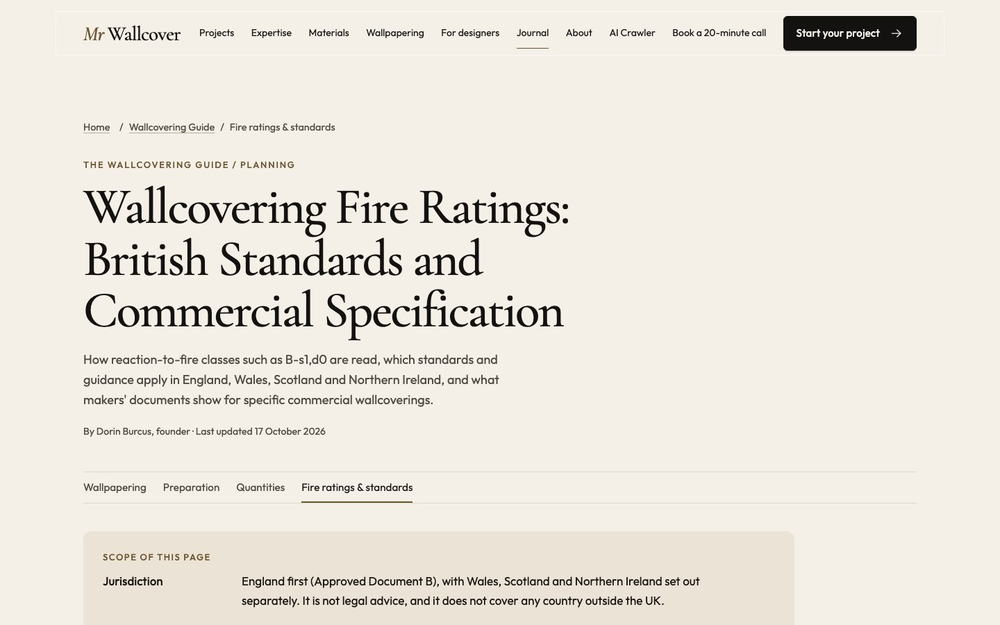
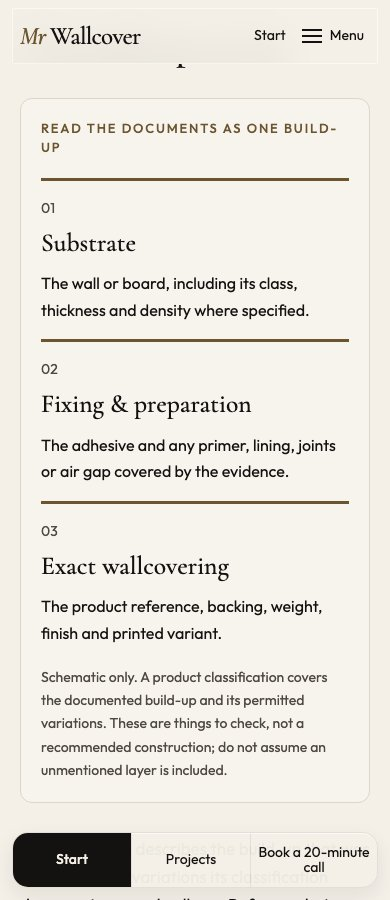
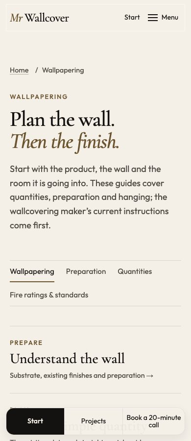

# Independent fire-reference release — 17 October 2026

## Release boundary

Branch `codex/fire-ratings-release` starts at PR #66 (`28bd059`), which installs the shared visual standard on current public main. It extracts the fire-reference changes from PR #64 (`6960fc2`) relative to the calculator base (`f83dc61`). It does not merge #62, #63, #64 or #65, and does not include their branch history. It also merges current public main (`2849676`, PR #67) to retain the public privacy cleanup, then the updated #66 foundation (`22a0ab5`) to retain its complete visual patterns, route-review register and checks. Both new routes have specific decisions in that register.

The advanced calculator is still awaiting real-job calibration. That hold does not need to delay this reference. This branch adds a small `/wallpapering/` front door that links to the existing published preparation, quantity and hanging guides, plus the fire reference. It keeps the established simple quantity guide. The advanced calculator, materials/paste dataset, separate preparation and adhesive routes and analytics setup from the other stack are outside this release. The names guard is inherited independently from main’s privacy cleanup.

The review sequence is **#66, then this release**. A squash merge of #66 requires deliberate retargeting of this branch to main, preserving only this release's changes. Do not squash-merge a parent stack merely to obtain the page. The original #64/#65 branches remain available for their later integration; their overlapping fire files must be reconciled with this release.

No merge, deployment or indexing is performed by preparing or opening this PR. Owner wording and maintenance decisions are recorded in the research README; they are not a claim of professional fire-engineering approval.

## Content and design

- Retains the 26 product/family records and 133 public primary-source records from the reviewed fire reference, with per-row limitations, dates, conflicts and unresolved evidence.
- Corrects the Muraspec woven Type I row: both smoke subclasses are printed; no single normalised class is chosen while applicability is unresolved.
- Corrects the overview's Scotland/Northern Ireland shared-parts exclusion to preserve the narrow firefighter-facilities maintenance duty already described and sourced in the detailed section.
- Uses the #66 `Base`, shared footer, `Action` and Guide cards. The original `FireEvidenceDiagram` component explains the three things that must match the evidence; it is expressly schematic, not an approved assembly or a certification badge. Body photography would risk implying that a photographed project used the products/classes discussed, so the page uses this diagram and its existing neutral typographic share card instead.
- The Article image now uses the same typographic share card as the visible page metadata, avoiding unrelated hotel imagery.
- Keeps "Fire ratings & standards" in the Wallpapering sub-menu, the Guide library and the footer. The header links the Wallpapering hub; it has no separate fire link. No fire article or claim block is added to the homepage.
- Keeps citations, the product table, source library and checklists readable without JavaScript. The decoder is an optional enhancement. Product classification text remains at least 14px; the comparison table uses the available reading width.

## Verification

Executed locally against the extracted release:

| Check | Evidence |
| --- | --- |
| Build and source/data tests | Build succeeds; 98 source/data tests pass. |
| Responsive fire reference and hub | Six widths: 360, 390, 768, 1024, 1280 and 1440px; no document overflow; sub-menu targets at least 44px; the draft routes are absent. |
| Decoder, keyboard and no JavaScript | Valid/invalid/legacy input checked; keyboard tab order, mobile menu and Escape checked; all 26 evidence rows remain available with JavaScript disabled. |
| Existing typography and hero contrast | Both `check:type` checks pass using Chrome for Testing. The new page additionally checks classification text size in its browser test. |
| Preservation against a fresh main build | No-loss passes: 98 existing routes retained (100 now); 3,609 existing media files retained (3,610 now); 98 existing Markdown twins retained (100 now); no project gallery loss or JSON-LD reduction. |
| Source URL check | 129 HTTP 2xx responses, four redirects, zero failed URLs. The command correctly exits with review flags for redirected sources, stated validity dates and unclear product status. It is not a clean technical-evidence approval. Hash mode was not run in this release pass. |

Final verification: `npm run check` 98/98; `npm run build` passed; `npm run check:dist` 211/211, plus the new-route and phone-enabled browser fixture; `npm run check:type` 2/2; `npm run check:phone` 2/2; `npm run build:review` passed; `npm run check:guides` 5/5. Case-study dates and whitespace checks pass. The no-loss command used a fresh build of `upstream/main` as its baseline. The strict names guard, inherited from main, passes against the built site and tracked repository using the private list by path: none of its 64 entries match. Its five unit tests also pass. The list remains outside the public repository and is never printed. No private archive, exclusion list, client file or manufacturer PDF is included.

Inspected screenshots:

The foundation’s sitewide visual audit also passes for every normal published and utility route at 390px and 1440px. The reproducible focused browser test is `tests/fire-release-browser.test.ts` (included in `check:dist`). Full local captures and machine reports are ignored under `.review-screens/fire-release/`; the three representative screenshots above are retained for review.

## Remaining publication steps

1. Required hosted checks and owner review of the release PR.
2. Authorised merge of #66, then retarget/reconcile and merge this release. Do not release the uncalibrated calculator as a dependency.
3. Verify the deployed URL, canonical, source links, sitemap and enquiry handoff on the actual public domain.
4. Request indexing only through an already-authorised workflow. Crawlability, submission and confirmed indexing are separate states; none is asserted here.

Manufacturer evidence gaps remain open and visible. Further residential and international coverage is a separate editorial expansion; the title and scope remain focused on the commercial UK reference actually supplied.
